# BioSynth Digital Twin Architecture

Digital Twin Challenge 2026 architecture documentation for the BioSynth proof of concept.

## System summary

BioSynth combines synthetic static EHR profiles with dynamic synthetic CGM replay to estimate whether a new glucose excursion above 180 mg/dL may begin within the next 120 minutes. The deployed dashboard supports two runtime modes:

- `EHR_CGM_FUSION`: 18 historical CGM trajectory features plus 11 encoded EHR features.
- `CGM_ONLY`: the existing 18-feature CGM trajectory baseline.

The CGM-only model is a comparison baseline and is not part of the fusion prediction path.

## Architecture diagram

```mermaid
flowchart TB
    subgraph OFFLINE["Offline training and evaluation pipeline"]
        HALL["Hall 2018 real CGM proof-of-signal<br/>Real CGM only<br/>No EHR fusion validation"]
        SYNCGM["Dynamic synthetic CGM<br/>100 virtual participants<br/>5-minute glucose readings"]
        SYNEHR["Static synthetic EHR<br/>100 participant profiles"]
        EVENTS["Synthetic event labels<br/>New >180 mg/dL excursion<br/>begins within next 120 min"]
        CGMFEAT["Historical CGM window<br/>60 minutes at or before timestamp<br/>18 trajectory features"]
        EHRFEAT["EHR feature encoding<br/>11 static features"]
        FUSION["EHR + CGM fusion matrix<br/>29 total features"]
        BASELINE["CGM-only comparison model<br/>18 trajectory features<br/>separate baseline"]
        TRAIN["Logistic Regression model<br/>median imputation + scaling<br/>class_weight=balanced"]
        EVAL["Participant-separated evaluation<br/>GroupKFold by person_id<br/>MIXED fusion results"]

        HALL --> BASELINE
        SYNCGM --> CGMFEAT
        SYNCGM --> EVENTS
        SYNEHR --> EHRFEAT
        CGMFEAT --> FUSION
        EHRFEAT --> FUSION
        EVENTS --> TRAIN
        FUSION --> TRAIN
        CGMFEAT --> BASELINE
        TRAIN --> EVAL
        BASELINE --> EVAL
    end

    subgraph LIVE["Live replay and inference pipeline"]
        DASHINPUT["Streamlit replay timestamp"]
        LIVE_CGM["CGM history filter<br/>timestamp <= replay timestamp<br/>no future CGM"]
        LIVE_EHR["Static EHR profile supplied explicitly<br/>no person_id lookup inside model"]
        LIVE_FEAT["Runtime feature assembly<br/>18 CGM + 11 EHR = 29 features"]
        MODEL["Final fusion model artifact<br/>Logistic Regression"]
        TWIN["BioSynthTwin runtime<br/>model_mode=EHR_CGM_FUSION"]
        DASH["Streamlit dashboard"]
        RISK["120-minute pre-event risk<br/>Digital twin state"]

        DASHINPUT --> LIVE_CGM
        DASHINPUT --> LIVE_EHR
        LIVE_CGM --> LIVE_FEAT
        LIVE_EHR --> LIVE_FEAT
        LIVE_FEAT --> MODEL
        MODEL --> TWIN
        TWIN --> DASH
        DASH --> RISK
    end
```

## Live fusion path

1. Static synthetic EHR is loaded from `data/02_synthetic/ehr/synthetic_ehr.csv`.
2. The dashboard selects the `SYN-0085` profile and supplies it explicitly to `BioSynthTwin`.
3. Synthetic CGM replay is filtered to rows with `timestamp <= replay_timestamp`.
4. The runtime calculates a 60-minute historical CGM window and derives 18 trajectory features.
5. The runtime encodes the static EHR profile into 11 numeric features.
6. The final fusion model consumes exactly 29 ordered features.
7. The Streamlit dashboard displays the selected model mode, current glucose state, and 120-minute pre-event risk.

## Offline training and evaluation path

The final fusion model was trained on all 198,000 synthetic fusion rows after participant-separated evaluation was completed. Validation metrics recorded in model metadata come from out-of-fold evaluation, not training-set scores.

The evaluation compared:

- Current-glucose baseline: 1 feature.
- CGM trajectory model: 18 features.
- EHR + CGM fusion model: 29 features.

## Target definition

The prediction target is `pre_event_target`: whether a new glucose excursion above 180 mg/dL begins within the next 120 minutes.

At runtime, the prediction input uses only CGM history available at or before the replay timestamp. Future CGM readings and future event labels are excluded from model input.

## Evaluation summary

| Model | Feature stream | PR-AUC | ROC-AUC |
| --- | --- | ---: | ---: |
| CGM trajectory | Dynamic CGM only | 0.4433 | 0.8539 |
| EHR + CGM fusion | Static EHR + dynamic CGM | 0.4352 | 0.8729 |

Result label: **MIXED**.

Fusion improved ROC-AUC but slightly reduced overall PR-AUC compared with the CGM trajectory model. It should not be described as universally superior.

## Data boundaries

- Hall 2018: real CGM proof-of-signal for CGM trajectory modeling only.
- Synthetic CGM: generated 5-minute glucose readings for 100 virtual participants.
- Synthetic EHR: generated static EHR-like profiles for the same 100 virtual participants.

Hall 2018 did not validate EHR + CGM fusion. The EHR + CGM fusion model is trained and evaluated only on synthetic BioSynth POC data.

## Runtime boundaries

- `simulation_phenotype` is not a model input.
- `person_id` is not a model input.
- Future CGM values are not passed into either runtime mode.
- Future event labels are not passed into either runtime mode.
- Static EHR is supplied explicitly in fusion mode.
- Fusion mode does not silently fall back to CGM-only mode when EHR is missing.

## Limitation

BioSynth is a synthetic hackathon proof of concept. Static EHR profiles were generated from phenotype-aligned simulator metadata, and synthetic CGM trajectories were also influenced by phenotype. The fusion system demonstrates two-stream digital-twin architecture, not clinical validation or clinically validated personalization.
