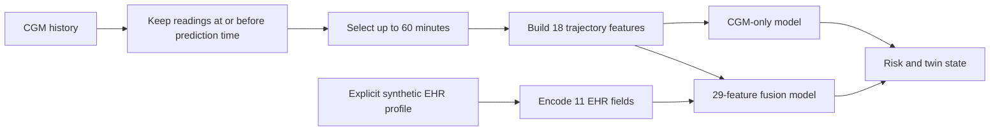

# BioSynth technical guide

This guide introduces the current BioSynth proof of concept and gives the practical commands for running its interfaces, rebuilding synthetic model artifacts, and checking the runtime. It describes the repository as it exists today; generated `.joblib` files may be absent from a fresh clone.

## What the project does

BioSynth estimates whether a new glucose excursion above 180 mg/dL may begin in the next 120 minutes. The runtime summarizes up to 60 minutes of CGM history available at or before the prediction time. It can use CGM alone or add a static synthetic EHR profile.

The project uses two kinds of evidence for different purposes:

- Hall 2018 CGM data supports a proof-of-signal analysis for CGM trajectory features.
- Simulated CGM and EHR data supports repeatable model development and dashboard demonstrations.

Hall 2018 does not validate the synthetic fusion model. None of the project outputs are clinically validated or intended for medical decisions.

## Choose an interface

There are two Streamlit applications in the repository.

| Entry point | Purpose | Model artifacts required? |
| --- | --- | --- |
| `ui/app.py` | BioSynth command-center UI with overview, forecast, intervention sandbox, explainability, cohort replay, and settings views. It attempts to load the CGM-only model and shows a calibrated simulation path if loading fails. | No, for the simulation path. A trained CGM-only artifact is needed for live model inference. |
| `app.py` | Guided replay for a detected synthetic event using the `BioSynthTwin` runtime. | Yes. It loads the CGM-only or fusion artifact selected in the UI. |

The interfaces serve different purposes. The command center is the visual dashboard; the root app demonstrates the explicit model-backed event-replay flow.

## Install and run

Use Python 3.11 or newer. From the repository root, run:

```powershell
python -m venv .venv
.\.venv\Scripts\Activate.ps1
python -m pip install -r requirements.txt
```

Run the command center:

```powershell
streamlit run ui/app.py
```

Run the model-backed event replay after building its artifacts:

```powershell
streamlit run app.py
```

Run the focused runtime check from an environment with the model artifact available:

```powershell
python scripts/demo_digital_twin.py
```

Run the automated runtime tests:

```powershell
python -m unittest discover -s tests -v
```

In Windows PowerShell, if you do not activate `.venv`, run `./.venv/Scripts/streamlit.exe run ui/app.py` or `./.venv/Scripts/python.exe -m unittest discover -s tests -v`.

## Prediction flow



`BioSynthTwin` loads a saved scikit-learn pipeline and JSON metadata. The metadata provides the exact feature order. `CGM_ONLY` requires 18 features. `EHR_CGM_FUSION` requires 29, and the caller must provide the EHR profile explicitly. Missing fusion fields or artifacts produce an error; fusion does not silently switch modes.

The returned risk is a model probability for the project label. The `LOW`, `ELEVATED`, and `HIGH` states use demonstration thresholds (below 0.30, 0.30–0.59, and 0.60 or higher). They are not clinical categories.

## Rebuild the synthetic artifacts

Run the commands from the project root in this order. Each script writes generated data or reports under `data/`, `reports/`, or `models/`.

```powershell
python scripts/generate_synthetic_cgm.py
python scripts/analyze_synthetic_cgm.py
python scripts/build_synthetic_prediction_dataset.py
python scripts/build_synthetic_trajectory_features.py
python scripts/generate_synthetic_ehr.py
python scripts/build_ehr_cgm_fusion_features.py
python scripts/cross_validate_synthetic_models.py
python scripts/cross_validate_ehr_cgm_fusion.py
python scripts/train_synthetic_final_model.py
python scripts/train_ehr_cgm_final_model.py
```

The runtime reads these model artifacts:

| Runtime mode | Model | Metadata |
| --- | --- | --- |
| `CGM_ONLY` | `models/biosynth_trajectory_model.joblib` | `models/biosynth_trajectory_model_metadata.json` |
| `EHR_CGM_FUSION` | `models/biosynth_ehr_cgm_fusion_model.joblib` | `models/biosynth_ehr_cgm_fusion_metadata.json` |

The model binaries are generated outputs and are ignored by Git. Metadata JSON files and evaluation summaries document the reference feature schema and evaluation results.

For the Hall 2018 proof-of-signal branch, run:

```powershell
python scripts/validate_hall2018.py
python scripts/analyze_hyperglycemic_events.py
python scripts/build_prediction_dataset.py
python scripts/build_cgm_trajectory_features.py
python scripts/cross_validate_baseline_models.py
```

The Hall source data is not included in this repository. Use only data you are authorized to access and follow the input paths defined in `configs/data_sources.yaml`.

## Current evaluation snapshot

The checked-in synthetic cross-validation summaries report participant-separated five-fold `GroupKFold` results over 100 simulated participants and 198,000 prediction rows.

| Model | Features | PR-AUC | ROC-AUC |
| --- | ---: | ---: | ---: |
| Current glucose baseline | 1 | 0.1918 | 0.7303 |
| CGM trajectory | 18 | 0.4433 | 0.8539 |
| EHR + CGM fusion | 29 | 0.4352 | 0.8729 |

These are out-of-fold results on synthetic data. Fusion raises ROC-AUC and lowers PR-AUC slightly versus CGM trajectory, so the result is mixed. See the [model card](model_card.md) for interpretation and limitations.

## Where to look in the code

| Concern | Source of truth |
| --- | --- |
| Runtime validation, feature construction, risk states | `src/biosynth_twin.py` |
| Model feature schema and EHR encoding | `scripts/build_ehr_cgm_fusion_features.py` and model metadata JSON |
| Command-center UI and visual styling | `ui/app.py`, `ui/assets/style.css`, `ui/assets/` |
| Guided event replay | `app.py` |
| Data generation and evaluation | `scripts/` |
| Runtime contract checks | `tests/test_biosynth_twin.py` |
| Data and model configuration | `configs/` |

For exact runtime arguments and returned fields, see the [API reference](api_reference.md). For column definitions, see the [data dictionary](data_dictionary.md).
