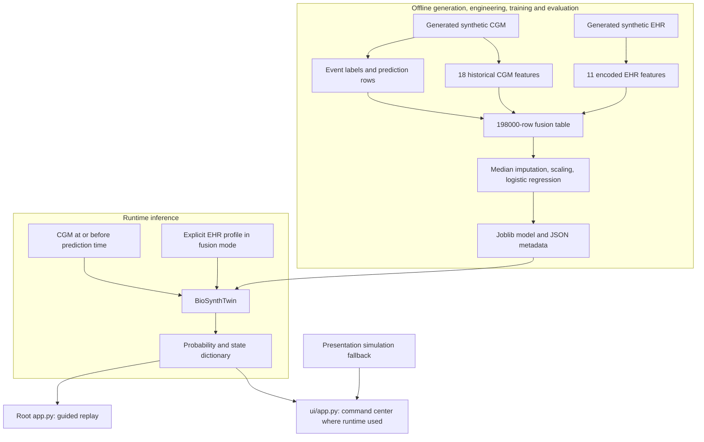

# BioSynth Digital Twin — Complete Technical, Medical & Machine Learning Study Guide

**Edition:** October 24, 2026  
**Audience:** Students, project presenters, hackathon judges, software engineers, and beginner-to-intermediate ML learners  
**Format:** Self-contained Markdown reference, worked examples, technical viva preparation, and file-by-file walkthrough

> **Research proof of concept—not a medical device.** BioSynth uses synthetic CGM and EHR data for its fusion system. The real Hall 2018 CGM dataset supports a separate *CGM-only* proof-of-signal investigation and does **not** validate EHR+CGM fusion. The project is not clinically validated and must not be used for diagnosis, treatment, dosing, or individual patient decisions.

---

## How to use this guide

This document explains BioSynth from first principles to implementation details. You can read it in order or jump to a topic using the table of contents. All project-specific assertions are based on the supplied repository documentation and historical working-context notes; general medical or ML background is marked as explanation rather than a measured BioSynth result. Hypothetical data, coefficients, scores, and confusion matrices are **examples, not outputs observed in BioSynth**.

**Main supplied source documents** (the file names here are the filenames supplied for this study guide):

1. `README.md` — documentation index and POC boundaries.
2. `data_dictionary.md` — actual field and feature definitions.
3. `model_card.md` — modeling contract, evaluation numbers, and limitations.
4. `architecture.md` — component ownership and offline/runtime boundaries.
5. `BIOSYNTH_ARCHITECTURE.md` — high-level project architecture and replay flow.
6. `BIOSYNTH_ARCHITECTURE.pdf` — two-page visualization of the architecture and evidence boundaries.
7. `BIOSYNTH_TECHNICAL_GUIDE.md` — installation, script sequence, execution, tests.
8. `api_reference.md` — `BioSynthTwin` runtime inputs, modes, outputs, errors.
9. `frontend_guide.md` — command-center Streamlit interface and fallback behavior.
10. `documentation-research.md` — documentation practices and maintenance rules.
11. `digital_twin_context_updated_full.md` — **historical working context** for the Hall 2018 pipeline. Some tasks described as 'next' in these older notes were subsequently implemented in the newer synthetic model documentation; do not mistake an old planning status for the repository's later documented model status.

### Contents

- [1. The project in plain English](#1-the-project-in-plain-english)
- [2. All essential medical concepts](#2-all-essential-medical-concepts)
- [3. CGM, timestamps, and the meaning of time series](#3-cgm-timestamps-and-the-meaning-of-time-series)
- [4. EHR fields, one-hot encoding, and data layers](#4-ehr-fields-one-hot-encoding-and-data-layers)
- [5. Targets, events, windows, and leakage](#5-targets-events-windows-and-leakage)
- [6. Deep explanation of all 18 CGM features](#6-deep-explanation-of-all-18-cgm-features)
- [7. From raw rows to the 29-feature fusion table](#7-from-raw-rows-to-the-29-feature-fusion-table)
- [8. Machine Learning from zero](#8-machine-learning-from-zero)
- [9. Logistic Regression mathematically](#9-logistic-regression-mathematically)
- [10. Preprocessing, imbalance, and fitting](#10-preprocessing-imbalance-and-fitting)
- [11. Correct evaluation and GroupKFold](#11-correct-evaluation-and-groupkfold)
- [12. Confusion matrix and classification metrics](#12-confusion-matrix-and-classification-metrics)
- [13. ROC-AUC versus PR-AUC: actual BioSynth results](#13-roc-auc-versus-pr-auc-actual-biosynth-results)
- [14. Hall 2018: real-CGM analysis](#14-hall-2018-real-cgm-analysis)
- [15. Software architecture and the live runtime](#15-software-architecture-and-the-live-runtime)
- [16. The two Streamlit applications](#16-the-two-streamlit-applications)
- [17. Data generation, training commands, and tests](#17-data-generation-training-commands-and-tests)
- [18. Source-by-source reading notes](#18-source-by-source-reading-notes)
- [19. Key limitations, risks, and evidence boundaries](#19-key-limitations-risks-and-evidence-boundaries)
- [20. Judge / viva questions with answers](#20-judge--viva-questions-with-answers)
- [21. Glossary of technical and medical terms](#21-glossary-of-technical-and-medical-terms)
- [22. Formula sheet and worked examples](#22-formula-sheet-and-worked-examples)
- [23. Five-minute, ten-minute, and thirty-second explanations](#23-five-minute-ten-minute-and-thirty-second-explanations)
- [24. Final checklist and source map](#24-final-checklist-and-source-map)

---

# 1. The project in plain English

## 1.1 The question

Consider a virtual participant with glucose measurements over the preceding hour. Their glucose might be rising, falling, or oscillating. Imagine also having a background health profile, including age, body-mass index (BMI), HbA1c, fasting glucose, family history, hypertension history, sex category, and activity category. BioSynth asks:

> **Can we estimate whether a *new* glucose excursion strictly above 180 mg/dL will begin within the next 120 minutes, using glucose history available at prediction time and, in fusion mode, an explicitly supplied synthetic EHR profile?**

The event threshold (>180 mg/dL), 60-minute historical lookback, and 120-minute future horizon are **project engineering definitions**, not an independently validated medical decision rule.

A conventional threshold detector might say: *The reading is already 190 mg/dL; therefore the threshold has been crossed.* A pre-event model asks: *Before a threshold-crossing episode begins, do earlier patterns imply that it may begin soon?* These are different tasks.

## 1.2 The two model modes

| Runtime mode | Model input | Purpose |
|---|---:|---|
| `CGM_ONLY` | 18 historical CGM trajectory features | Comparison baseline and runnable model mode |
| `EHR_CGM_FUSION` | 18 historical CGM + 11 encoded static EHR features = **29** | Demonstrate two-stream feature fusion |

The architecture diagram's CGM-only comparison model is **not secretly embedded inside the fusion predictor**. These are alternative models built from different feature streams. The root guided replay can select between them. The command-center UI currently attempts a CGM-only runtime and may use simulation when required model binaries are missing.

## 1.3 The two evidence streams

**Real-CGM branch:** Hall 2018 contains CGM observations for 57 participants. It was used for feasibility, event analysis, feature work, and CGM trajectory signal investigation. It does **not** provide real EHR+CGM fusion validation.

**Synthetic fusion branch:** The project generated 5-minute CGM streams for 100 virtual participants and one static EHR-like record for each. The reported fusion metrics come from 198,000 synthetic prediction-window rows, evaluated with participant-separated five-fold cross-validation. The synthetic records are not actual patient records.

Keep these streams separate every time you describe model performance. Synthetic cross-validation is useful engineering evidence but does not establish deployment safety or clinical generalization.

## 1.4 The key project numbers

| Item | Documented value | Interpretation |
|---|---:|---|
| Real Hall participants | 57 | CGM proof-of-signal source |
| Historical Hall CGM readings | 105,426 | Raw observations recorded in Hall working context |
| Hall feature rows | 89,329 | Hall proof-of-signal feature / prediction rows |
| Synthetic virtual participants | 100 | Simulator-created participant cohort |
| Synthetic CGM schedule | Every 5 minutes for 7 days | Regular generated sequence |
| CGM observations per participant | 2,016 | 288/day × 7 days |
| Total synthetic raw CGM | 201,600 | 2,016 × 100 |
| Synthetic EHR rows | 100 | Exactly one per virtual participant |
| Synthetic prediction rows | 198,000 | Prediction timestamps and labels |
| Synthetic fusion feature rows | 198,000 | 29-feature training examples |
| Synthetic positives | 23,696 | Positive `pre_event_target` rows |
| Synthetic positive prevalence | 11.97% | 23,696 / 198,000 |
| Lookback | 60 minutes | Past CGM used to create inputs |
| Horizon | 120 minutes | Future interval for onset label |
| Event threshold | Strictly >180 mg/dL | POC engineering condition |
| CGM features | 18 | Dynamic summaries |
| Encoded EHR features | 11 | Static profile inputs |
| Fusion features | 29 | Combined input vector |
| Evaluation | Five-fold GroupKFold by `person_id` | Keeps participants separated |

## 1.5 What is—and is not—a Digital Twin here?

A **Digital Twin** is a computational representation of a physical or biological system that can be updated using observations and used to inspect state, predictions, or possible scenarios. In a rigorous biological context, it may also contain mechanistic models of physiology, individually estimated parameters, continual updating, and intervention validation.

BioSynth presently demonstrates **part** of that vision: generated participant profiles, replayed CGM measurements, historical-state feature extraction, ML risk estimation, and an interface for state presentation and illustrative intervention scenarios. It does **not** validate a mechanistic, continuously calibrated physiological twin of an actual patient. The word “twin” describes a POC architecture rather than a certified clinical digital replica.

---

# 2. All essential medical concepts

The following section provides **general medical education** to understand the feature names. These general concepts are not measurements or medical claims established by BioSynth's synthetic modeling experiment.

## 2.1 Glucose and metabolism

**Glucose** is a simple sugar (chemical formula `C6H12O6`) that serves as an important source of energy. Dietary carbohydrates can be broken down into glucose or other sugars during digestion. Glucose enters the blood and is distributed to organs and tissues. The liver can store glucose in glycogen and can also release or produce glucose. Several hormones, including insulin and glucagon, help regulate glucose levels.

**Metabolism** describes the chemical reactions by which living organisms obtain, use, store, and transform energy and matter. **Glycemic** means relating to blood glucose or glucose regulation. **Postprandial** means after eating; **fasting** means without caloric intake for a defined period. The body's glucose level can vary with meals, exercise, sleep, illness, medications, hormones, and other factors.

**Blood glucose** is the concentration of glucose in blood. CGM devices generally estimate glucose in **interstitial fluid**, the fluid surrounding cells beneath the skin, rather than directly drawing blood for each sample. The two glucose concentrations are related but can differ, especially when glucose changes rapidly.

## 2.2 What is `mg/dL`?

`mg/dL` means **milligrams per deciliter**: a milligram is one thousandth of a gram; a deciliter is 100 milliliters (one tenth of a liter). It is a concentration unit, not a number of sugar molecules or total sugar mass in the body. Many countries also report glucose in `mmol/L` (millimoles per liter). The commonly used approximate glucose conversion is `mmol/L = mg/dL / 18.018`.

BioSynth's engineering threshold `>180 mg/dL` means **strictly greater than** 180. At exactly 180.0, the Boolean `current_is_high` is 0 according to the data dictionary; at 180.1, it is 1.

## 2.3 Pancreas, insulin, glucagon, and beta cells

The **pancreas** is an organ with digestive and hormonal functions. Pancreatic **beta cells** produce **insulin**, a hormone that helps regulate blood glucose, including by promoting glucose uptake in selected tissues and reducing glucose production by the liver. Pancreatic **alpha cells** produce **glucagon**, which helps raise blood glucose under appropriate conditions. This is a simplified picture of a complex regulatory system.

**Insulin resistance** occurs when cells or tissues respond less effectively to insulin. **Insulin deficiency** means inadequate insulin availability relative to the body's needs. Both can contribute to elevated glucose. These are physiological concepts; BioSynth's 29-feature classifier does not directly solve mechanistic insulin dynamics.

## 2.4 Diabetes mellitus, Type 1, Type 2, prediabetes

**Diabetes mellitus** describes conditions in which glucose regulation is sufficiently impaired to cause chronic hyperglycemia.

- **Type 1 diabetes (T1D):** often an autoimmune process damages insulin-producing beta cells, creating substantial insulin deficiency.
- **Type 2 diabetes (T2D):** involves insulin resistance and insufficient compensatory insulin secretion; its development and presentation vary among individuals.
- **Prediabetes:** describes glucose-regulation measurements above the usual normal range but not meeting diabetes diagnostic criteria; progression to diabetes is not inevitable.
- **Gestational diabetes:** diabetes identified during pregnancy under specified diagnostic criteria.

The historical Hall metadata classified its participants as 38 no-diabetes, 14 prediabetes, and 5 T2D. The synthetic generator uses labels such as `No diabetes-like`, `Prediabetes-like`, and `T2D-like` to characterize **simulated phenotypes**. A synthetic `T2D-like` label is **not a clinical diagnosis**.

## 2.5 Hyperglycemia, hypoglycemia, event onset, excursion

**Hyperglycemia:** elevated glucose, with relevant thresholds depending on the medical question. BioSynth defines a **POC event** as a newly detected excursion with readings strictly above 180 mg/dL. That threshold is *not presented as a validated event-detection rule for this clinical purpose*.

**Hypoglycemia:** low glucose. In diabetes management, below 70 mg/dL is commonly used as an alert-level reference, but individual context matters. This threshold is **not** BioSynth's modeling target. The Hall working context recorded nine textual readings of `Low`; they were kept as nonnumeric observations rather than replacing them with an invented mg/dL value.

**Excursion:** a departure from a selected level or range. **Event onset:** the beginning of a detected episode. **Peak glucose:** the highest observed value during an event. **Duration:** measured or estimated time between detected event start and end. With discrete CGM samples, duration is not necessarily equal to the precise biological interval. **Lead time:** amount of time a warning precedes the event onset. **Time to peak:** interval from event onset to its maximum observed glucose.

*Illustrative event:* 10:00 = 165; 10:05 = 177; 10:10 = 184; 10:15 = 199; 10:20 = 195; 10:25 = 173 mg/dL. In the simple threshold interpretation, onset is at 10:10, peak observed glucose is 199 at 10:15, and a warning issued at 9:40 would have a 30-minute lead time. Actual event grouping in the Hall pipeline also respects segment and gap rules.

## 2.6 Continuous Glucose Monitoring (CGM)

A **continuous glucose monitor** uses a wearable sensor to estimate interstitial glucose repeatedly over time. “Continuous” denotes regular monitoring, not necessarily a new output every millisecond. BioSynth's synthetic generator uses a five-minute grid. A one-hour interval contains twelve five-minute gaps and, if both endpoints are sampled, **thirteen timestamps**. This distinction explains why a full inclusive 60-minute history may contain 13 measurements despite 12 intervals per hour.

CGM observations have two main columns in this project:

```csv
timestamp,glucose_value_mg_dl
2026-01-04 12:00:00,162.0
2026-01-04 12:05:00,168.0
2026-01-04 12:10:00,176.5
```

The sensor can have **missing readings**, **noise**, **gaps**, **calibration differences**, or categorical values. A **timestamp** records when the sample was made. A **sampling interval** is the difference between consecutive timestamps. In real data, a sensor's nominal schedule does not guarantee that every recorded interval has that length.

## 2.7 HbA1c and glycated hemoglobin

**Hemoglobin** is an oxygen-carrying protein in red blood cells. **Glycation** is non-enzymatic attachment of sugar molecules to proteins. **HbA1c** is a measurement of glycated hemoglobin and reflects longer-term average glucose exposure, approximately the preceding two to three months, with greater influence from more recent weeks.

Illustrative general adult diagnostic reference categories commonly used in some guidelines:

| HbA1c | General interpretive category |
|---|---|
| Below 5.7% | Usually below the prediabetes threshold |
| 5.7% to 6.4% | Prediabetes range |
| 6.5% or above | Diabetes range, subject to appropriate confirmation and context |

These are **background medical reference concepts, not thresholds learned or validated by BioSynth**. HbA1c can be affected by red-cell disorders, hemoglobin variants, or altered red-cell turnover. Do not describe HbA1c as “the current blood sugar.” It summarizes longer-term exposure; CGM shows relatively short-term trajectories.

## 2.8 Fasting glucose

**Fasting glucose** measures glucose after a specified period without caloric intake, often at least eight hours in clinical testing. It is not the same thing as the current CGM sample. Common adult fasting plasma glucose categories used in general education are <100 mg/dL, 100–125 mg/dL, and ≥126 mg/dL for normal, prediabetes-range, and diabetes-range results respectively, subject to the clinical context and diagnostic confirmation. BioSynth uses a **synthetically generated fasting-glucose value as a numeric EHR feature**, not as a diagnosis engine.

## 2.9 Body Mass Index (BMI)

**BMI** = mass (kg) divided by height (m) squared:

\[
BMI = \frac{m_{kg}}{h_m^2}
\]

For 70 kg and 1.75 m: `70 / (1.75 × 1.75) ≈ 22.86 kg/m²`. BMI is a screening proxy and does not directly measure fat distribution or individual cardiometabolic health. In BioSynth, `bmi_kg_m2` is a synthetic static numeric feature.

## 2.10 Hypertension, family history, activity level

**Hypertension:** chronically elevated blood pressure; BioSynth does not model a blood-pressure waveform, but has a synthetic history flag `hypertension_history`. **Systolic pressure** is arterial pressure during the contraction phase of the heart; **diastolic pressure** is pressure during the relaxation phase.

**Family history:** information about conditions among relatives; here `family_history_diabetes` is a yes/no indicator. It is not a deterministic statement that someone will develop diabetes.

**Activity level:** a coarse label such as `low`, `moderate`, or `high`; real exercise effects on glucose are more complex than a single categorical attribute. BioSynth encodes this field into three indicator columns.

## 2.11 Sex, gender, phenotype, genotype

**Sex** and **gender** are distinct concepts. The current project API supports two values for its synthetically generated `sex` field: `female` and `male`. This narrow API field should not be described as representing every dimension of real patients' sex or gender identity.

**Genotype:** genetic constitution. **Phenotype:** observable characteristics shaped by genes, environment, development, and other factors. **Simulation phenotype:** a generator-assigned grouping used to produce synthetic data. The project explicitly **excludes** `simulation_phenotype` from model inputs, as well as excluding `person_id` and generator parameters.

---

# 3. CGM, timestamps, and the meaning of time series

## 3.1 A time series is more than a list of numbers

A **time series** is a sequence of measurements associated with timestamps. Both value and time order matter. Glucose `[110,130,150,170]` represents a rising trend if recorded in that order, while `[170,150,130,110]` represents a falling trend. Both sequences share the same average (140) but convey different temporal behavior. **Trajectory** is the pattern or path of values through time.

**Static data** means data treated as unchanged over the replay interval, such as a synthetic participant's background EHR profile. **Dynamic data** means data updated or newly available across timestamps, such as CGM observations. BioSynth's core architectural contribution is the explicit combination of static and dynamic inputs at the **feature level**.

## 3.2 Timestamp parsing, sorting, and historical filtering

A timestamp must be interpretable as a date and time. Runtime validation parses timestamps, sorts readings, and drops unusable rows. It can raise `ValueError` when fields are missing, timestamps are invalid, no observations are usable, or the selected historical window has no numeric glucose.

The essential leakage guard is:

```python
historical = cgm[cgm["timestamp"] <= prediction_timestamp]
```

The runtime then uses up to the preceding 60 minutes of usable CGM history. `<=` permits the reading at the prediction timestamp. Future readings (strictly later timestamps) must not influence the input feature vector. The future horizon is consulted *offline for label construction*, not for runtime inference.

## 3.3 Gaps, missing samples, and temporal segments

Real CGM datasets may contain long recording gaps. The historical Hall analysis adopted the exploratory rule:

```text
Gap between consecutive readings >15 minutes -> start a new recording segment
```

This is an engineering choice documented for that pipeline, not a physiological fact. It prevents the analysis from stitching readings across a long unobserved period and pretending that glucose was continuously measured. If samples occur at 10:00, 10:05, 10:10, and 11:40, the 90-minute break must not be silently treated as another normal five-minute step.

The **mean** sampling interval can be distorted by rare large gaps. For `[5, 5, 5, 5, 180]` minutes, the mean is 40 minutes but the median is five. The median better describes the typical interval in this example.

## 3.4 Observation coverage versus requested window

A **requested lookback** of 60 minutes does not imply that every such window contains 60 minutes of observed numeric data. `trajectory_actual_history_minutes` measures the elapsed span between usable historical readings; `trajectory_numeric_count` counts numeric observations. This helps expose incomplete coverage rather than treating all windows as equally complete.

## 3.5 Why 60 minutes and 120 minutes?

The Hall working-context document compared historical lookbacks of 30, 60, and 120 minutes using a two-hour future horizon. The initial feasibility analysis recorded:

| Lookback | Valid windows | Positive windows | Positive rate |
|---|---:|---:|---:|
| 30 min | 91,273 | 2,367 | 2.59% |
| 60 min | 89,155 | 2,330 | 2.61% |
| 120 min | 85,199 | 2,278 | 2.67% |

These are **historical feasibility-analysis counts**, not the final synthetic fusion validation table. The working-context rationale was that 60 minutes offered recent context while retaining more valid windows than 120 minutes. Neither the 60-minute lookback nor 120-minute horizon is established as clinically optimal.

---

# 4. EHR fields, one-hot encoding, and data layers

## 4.1 EHR means Electronic Health Record

A real electronic health record may contain demographics, laboratory results, medical encounters, medications, diagnoses, allergies, and history. In this project, **synthetic static EHR** means a generated participant profile mimicking selected health-record fields, not a record obtained from a hospital. It supports demonstration of an additional information stream.

The project requires **exactly one synthetic EHR row for each synthetic participant**. In the documented demo, the application selects `SYN-0085` and checks that the match is not missing or duplicated. This `person_id` is used for data linkage but is not a predictive feature.

## 4.2 Source fields and their status

| Original field | Meaning | ML input? | Handling |
|---|---|---|---|
| `person_id` | Identifier for joining records | No | Linkage and grouping |
| `simulation_phenotype` | Generator-defined phenotype | No | Context only |
| `age_years` | Synthetic age | Yes | Numeric |
| `sex` | Synthetic sex category | Yes | One-hot encoding |
| `bmi_kg_m2` | Synthetic BMI | Yes | Numeric |
| `hba1c_percent` | Synthetic HbA1c | Yes | Numeric |
| `fasting_glucose_mg_dl` | Synthetic fasting glucose | Yes | Numeric |
| `family_history_diabetes` | Synthetic family-history flag | Yes | 0 or 1 |
| `hypertension_history` | Synthetic hypertension-history flag | Yes | 0 or 1 |
| `activity_level` | Synthetic activity category | Yes | One-hot encoding |
| `synthetic_data_note` | Record-generation disclaimer | No | Documentation only |

## 4.3 Numeric, Boolean, and categorical variables

A **numeric feature** is represented directly by a number, such as age 48 or BMI 24.7. A **Boolean** feature has true/false values and is typically encoded as 1/0. A **categorical** feature identifies membership in a set of named categories such as `low`, `moderate`, or `high`.

A model expecting a purely numeric 29-element vector cannot directly multiply a textual string by a learned coefficient. Categorical fields must be **encoded** into numeric values.

## 4.4 One-hot encoding explained

If `activity_level = "high"`, three binary columns represent the category:

| Activity input | `ehr_activity_low` | `ehr_activity_moderate` | `ehr_activity_high` |
|---|---:|---:|---:|
| `low` | 1 | 0 | 0 |
| `moderate` | 0 | 1 | 0 |
| `high` | 0 | 0 | 1 |

Similarly, `sex = "female"` becomes `ehr_sex_female = 1` and `ehr_sex_male = 0`; the reverse applies to `male`. The runtime accepts these two category values only, as documented in the API reference.

## 4.5 The eleven EHR feature columns—exact names

1. `ehr_age_years`
2. `ehr_bmi_kg_m2`
3. `ehr_hba1c_percent`
4. `ehr_fasting_glucose_mg_dl`
5. `ehr_family_history_diabetes`
6. `ehr_hypertension_history`
7. `ehr_sex_female`
8. `ehr_sex_male`
9. `ehr_activity_low`
10. `ehr_activity_moderate`
11. `ehr_activity_high`

The count is **4 numeric + 2 Boolean + 2 sex indicators + 3 activity indicators = 11**.

## 4.6 A complete illustrative encoding

```python
profile = {
    "age_years": 48,
    "sex": "female",
    "bmi_kg_m2": 24.7,
    "hba1c_percent": 5.1,
    "fasting_glucose_mg_dl": 82,
    "family_history_diabetes": True,
    "hypertension_history": False,
    "activity_level": "high",
}
```

This maps to an illustrative **EHR-only** vector (in the order listed above):

```text
[48, 24.7, 5.1, 82, 1, 0, 1, 0, 0, 0, 1]
```

Do not interpret these values as an actual BioSynth participant's clinical data merely because the structure matches the API example.

## 4.7 Why identifiers, ground truth, and future information are excluded

`person_id` is a join key and cross-validation group identifier; it is not a physiological measurement. `simulation_phenotype` describes how the data were generated and might give the model an artificial shortcut. Simulator parameters and event ground truth may directly reveal conditions that a real predictive model would not know. Future glucose summarizes the *answer*, not an allowed historical input. For these reasons the project excludes these from predictive features.

Excluding the explicit phenotype name is useful but **does not erase synthetic generator bias**: if the simulator made EHR values and future CGM patterns depend on the same phenotype assumptions, the remaining allowed inputs can still contain simulator-specific relationships. This is a documented limitation.

---

# 5. Targets, events, windows, and leakage

## 5.1 What are input features and target labels?

In **supervised learning**, every training example includes input variables `X` and a target label `y`. The model learns a mapping `f(X)` that aims to predict `y` for new examples.

BioSynth's main label is `pre_event_target`:

- `1` means a newly detected glucose event above the 180 mg/dL engineering threshold starts within the next 120 minutes.
- `0` means no new event starts within that period for an eligible non-underway window.
- A timestamp **inside an event underway** is a different context and is not interpreted as an ordinary pre-event warning point.

The label is allowed to use future observations during offline construction because it provides the correct answer for training. That future data must never be sent as a model input at runtime.

## 5.2 Two different target formulations

The Hall working context distinguished:

**Target A — `future_hyperglycemia`:** whether any future sample within two hours is above 180. This can include future high readings during an event already underway.

**Target B — `pre_event_target`:** whether a **new** high-glucose event begins within two hours, when prediction occurs before onset. This better matches the stated *early-warning* objective.

Mathematically, if `t` is the prediction time, `H = 120 min`, and `T_event` is the start of the next eligible new event:

\[
y_t=1 \quad \text{when } t < T_{event}\le t+H\]

The full label-building pipeline must also handle observation coverage, detected-event status, and other eligibility rules. This equation conveys the concept, not the complete source-code implementation.

## 5.3 Positive/negative example and class prevalence

A **positive example** is a prediction row whose target equals 1. A **negative example** has target 0. **Prevalence** or **positive rate** is the fraction of examples labeled positive. The final synthetic fusion table has 23,696 positive and 174,304 negative rows, yielding about 11.97% positive prevalence.

The older Hall primary-target dataset has 1,662 positive rows among 89,329 prediction rows, about 1.86%. These rates describe **different data sources and target-construction contexts**. They must not be mixed when interpreting baselines or performance.

## 5.4 Prediction timestamp, lookback, horizon, lead time

- **Prediction timestamp:** the point at which the model is asked to make a prediction, e.g. 11:00.
- **Lookback:** amount of historical data used, e.g. 10:00–11:00.
- **Horizon:** interval about which the future answer is asked, e.g. after 11:00 through 13:00.
- **Lead time:** interval from warning time to event onset, if a future event occurs.

Illustrative timeline:

```text
10:00               11:00                               13:00
  |----- 60 min -----|----------- 120 min -----------------|
         HISTORY     ^              FUTURE
                     prediction     event onset might occur
                     timestamp      somewhere in this span
```

## 5.5 Overlapping windows are not independent events

One event starting at 12:00 can create positive training windows at 10:30, 10:35, 10:40, ..., 11:55, depending on event and eligibility logic. They are distinct **rows** but refer to a shared physiological **event**. Neighboring historical windows also overlap heavily.

The historical Hall analysis reported 1,662 pre-event positive windows corresponding to **83 distinct events**. The median was 23 positive windows per event and the maximum was 24. Therefore 1,662 rows do not mean 1,662 separate events.

This dependence motivates participant-separated evaluation and suggests that future work should also consider event-level detection, lead-time, and false-alert-burden metrics.

## 5.6 Four important leakage modes

**Future leakage:** using glucose recorded after prediction time. **Target leakage:** using `future_max_glucose_mg_dl`, `future_hyperglycemia`, `event_status`, target event identifiers, or information constructed directly from the answer as predictive features. **Participant leakage:** allowing the same person's correlated records to appear in training and validation. **Preprocessing leakage:** fitting scalers or imputers on validation data before evaluation.

BioSynth addresses these through historical filtering, blocked future/event fields, GroupKFold by participant, and preprocessing fit inside training folds. No combination of guards proves all potential real-world generalization problems are solved, especially with a synthetic generator.

## 5.7 Fields that must not enter the model

The supplied dictionary and context explicitly exclude `person_id`, `simulation_phenotype`, future CGM, `pre_event_target`, future event labels, `event_id`, event statuses/ground truth, and simulator parameters from predictors. The Hall working context additionally lists audit-only fields such as `future_max_glucose_mg_dl`, `future_hyperglycemia`, `future_observation_count`, `actual_future_minutes`, `target_event_id`, and time-from/to-event variables as blocked for predictive use.

---
# 6. Deep explanation of all 18 CGM features

The data dictionary defines eighteen numeric CGM trajectory features. Below, each field is explained with its data type, mathematical interpretation, intuition, and relevant caveats. The features summarize **historical** data; they do not secretly include future glucose values.

## 6.1 A complete worked 60-minute trajectory

Use this **illustrative—not real patient and not observed evaluation data** series:

| Time | Glucose mg/dL | Minutes since 10:00 |
|---|---:|---:|
| 10:00 | 120 | 0 |
| 10:05 | 125 | 5 |
| 10:10 | 130 | 10 |
| 10:15 | 135 | 15 |
| 10:20 | 140 | 20 |
| 10:25 | 145 | 25 |
| 10:30 | 150 | 30 |
| 10:35 | 155 | 35 |
| 10:40 | 160 | 40 |
| 10:45 | 165 | 45 |
| 10:50 | 170 | 50 |
| 10:55 | 175 | 55 |
| 11:00 | 180 | 60 |

There are thirteen readings but only twelve gaps of five minutes each. The arithmetic mean and median are both 150. All values are at or below 180, so the *strictly above 180* count equals zero.

## 6.2 Feature-by-feature calculations

### 1. `current_glucose_mg_dl`

**Definition:** latest usable numeric glucose within the historical window. **Example:** 180 mg/dL at 11:00. A single current reading conveys the glucose level but cannot by itself distinguish a rapidly rising path from a falling path ending at the same value.

### 2. `current_is_high`

**Definition:** binary indicator equal to 1 if the current value is strictly greater than 180 mg/dL, otherwise 0. **Example:** `int(180 > 180) = 0`. This is a simple engineered threshold feature, not a diagnosis.

### 3. `history_mean_glucose`

**Definition:** arithmetic average of usable readings.

\[
\overline{G} = \frac{1}{n}\sum_{i=1}^{n}G_i
\]

**Example:** (120+125+...+180)/13 = **150** mg/dL. Mean describes central level but can be influenced by extreme observations.

### 4. `history_median_glucose`

**Definition:** middle value of the numerically sorted observations, or the average of the middle two for even count. **Example:** the seventh of thirteen values = **150** mg/dL. Median is less sensitive than mean to a small number of outlying readings.

### 5. `history_min_glucose`

**Definition:** minimum usable reading in the window. **Example:** **120** mg/dL. Minimum gives information about the lowest observed state, although one anomalous sensor value may distort it.

### 6. `history_max_glucose`

**Definition:** maximum usable historical reading. **Example:** **180** mg/dL. Maximum provides information about the highest *past* value; it must not be confused with `future_max_glucose_mg_dl`, which is a future-derived audit/label field explicitly excluded from input.

### 7. `history_range_glucose`

**Definition:** max − min.

\[
Range = G_{max}-G_{min}=180-120=\mathbf{60}\;mg/dL
\]

Range measures total observed spread. It does not tell whether the path rose or fell.

### 8. `glucose_change_15m`

**Definition:** latest glucose minus the value from approximately fifteen minutes earlier.

\[
\Delta G_{15}=G(t)-G(t-15\;min)
\]

At 11:00 the current value is 180, and at 10:45 it was 165: **+15 mg/dL**. Positive means rising over the interval; negative means falling. In irregular real data, the closest appropriate past reading may be used; exact matching behavior must be inspected in source code if a strict implementation claim is needed.

### 9. `glucose_change_30m`

At 10:30 the glucose was 150, so **180 − 150 = +30 mg/dL**. This captures a longer recent change.

### 10. `glucose_change_60m`

At 10:00 the glucose was 120, so **180 − 120 = +60 mg/dL**. Longer-offset changes can help distinguish persistent trends from short-lived fluctuations, although 60 minutes is only one engineering choice.

### 11. `glucose_slope_per_hour`

**Definition:** overall fitted rate of change in glucose, expressed in mg/dL/hour. Rather than only subtracting endpoints, a fitted linear slope takes the historical observations and their timestamps into account. For elapsed time `t_i` measured in hours and glucose `G_i`, least-squares slope is:

\[
\hat\beta_1=\frac{\sum_i(t_i-\bar t)(G_i-\bar G)}{\sum_i(t_i-\bar t)^2}
\]

Because the example rises exactly 5 mg/dL every 5 minutes, the fitted slope is **+60 mg/dL/hour**. A fitted slope can differ from the endpoint difference in an irregular or nonlinear series. It describes an observed trend, *not necessarily the person's actual future glucose change*.

### 12. `history_std_glucose`

**Definition:** sample standard deviation, which measures spread around the sample mean.

\[
s=\sqrt{\frac{\sum_{i=1}^{n}(G_i-\bar G)^2}{n-1}}
\]

Here the deviations from mean 150 are −30, −25, ..., 0, ..., +25, +30. Their squared sum is 4,550; `n − 1 = 12`; therefore `sqrt(4550/12) ≈` **19.47 mg/dL**. A high standard deviation means the observed values vary more in absolute terms. It does not independently establish whether variability is clinically concerning.

### 13. `history_cv_glucose`

**Definition:** coefficient of variation = sample standard deviation divided by mean.

\[
CV = \frac{s}{\bar G}=\frac{19.4722}{150}\approx\mathbf{0.1298}
\]

That ratio corresponds to **12.98%** if displayed as a percentage. The data dictionary specifies the raw ratio. CV measures relative variability, and it becomes difficult to interpret if a mean is zero or near zero; real implementations need appropriate safeguards.

### 14. `history_high_count`

**Definition:** number of usable readings **strictly** above 180 mg/dL. In this example none is greater than 180: **0**. A reading of exactly 180 does not count.

### 15. `history_high_fraction`

**Definition:** high count divided by usable numeric observation count.

\[
Fraction_{high}=\frac{N_{>180}}{N_{usable}}
\]

Here `0/13 = 0`. If instead four of thirteen readings exceeded 180, the fraction would be about `0.3077` (30.77%). This is a fraction of *sampled readings*, not always identical to the exact proportion of physical time spent above threshold when sampling is irregular.

### 16. `history_minutes_above_180`

**Definition:** approximate observed number of minutes above 180. In the worked series it is **0**. A simple regular five-minute-count approximation would assign four above-threshold samples about twenty sample-minutes of exposure, but exact boundary and integration conventions depend on implementation. The documentation calls this figure an **approximation**, so do not claim precise continuous-time hyperglycemia duration.

### 17. `trajectory_numeric_count`

**Definition:** number of usable numeric observations in the trajectory window. Here **13**. This describes data availability and helps distinguish a well-covered window from one with few measurements.

### 18. `trajectory_actual_history_minutes`

**Definition:** elapsed time span between first and last usable historical reading. Here **60 minutes**. If the requested 60-minute window has only observations from 10:20 to 11:00, its actual covered span would be 40 minutes, not 60.

## 6.3 All eighteen features together

| # | Feature | Worked example | Major information |
|---:|---|---:|---|
| 1 | `current_glucose_mg_dl` | 180 | Current state |
| 2 | `current_is_high` | 0 | Threshold state |
| 3 | `history_mean_glucose` | 150 | Average historical level |
| 4 | `history_median_glucose` | 150 | Robust central level |
| 5 | `history_min_glucose` | 120 | Minimum |
| 6 | `history_max_glucose` | 180 | Maximum |
| 7 | `history_range_glucose` | 60 | Absolute spread |
| 8 | `glucose_change_15m` | +15 | Short recent change |
| 9 | `glucose_change_30m` | +30 | Medium recent change |
| 10 | `glucose_change_60m` | +60 | Longer recent change |
| 11 | `glucose_slope_per_hour` | +60 | Fitted hourly trend |
| 12 | `history_std_glucose` | ≈19.47 | Absolute variability |
| 13 | `history_cv_glucose` | ≈0.1298 | Relative variability |
| 14 | `history_high_count` | 0 | Number of high readings |
| 15 | `history_high_fraction` | 0 | Share of high readings |
| 16 | `history_minutes_above_180` | 0 | Approximate high exposure |
| 17 | `trajectory_numeric_count` | 13 | Usable observations |
| 18 | `trajectory_actual_history_minutes` | 60 | Actual history coverage |

## 6.4 Why feature engineering matters

A **raw CGM stream** can contain hundreds of observations; a **feature vector** summarizes the relevant recent history into a fixed-length numeric representation. Logistic Regression can then combine these features using learned coefficients. Feature engineering can make simple models competitive and interpretable, but it discards some information about the detailed time ordering and sequence shape. A sequence model could use rawer temporal data, but no neural-sequence performance comparison is established by the uploaded model card.

## 6.5 Redundancy and correlation between features

Many features are related. The maximum and range share information; current glucose and `current_is_high` are associated; mean and median often track together; change over 60 minutes and fitted slope can be correlated. **Correlation** measures statistical association, not causation. **Multicollinearity** means predictor variables are strongly related; it can make individual logistic coefficients less stable, even if predictive ranking remains useful. This is one reason to interpret coefficient-based feature attribution carefully.

---

# 7. From raw rows to the 29-feature fusion table

## 7.1 What is a feature table?

A **feature table** contains one row per prediction example and columns for numeric features plus a separate label and metadata used for evaluation. BioSynth generates 198,000 synthetic prediction rows and 198,000 synthetic fusion feature rows from 100 virtual participants. Rows are not independent people. Multiple timestamps for the same participant create multiple rows.

## 7.2 What is a join?

A **join** combines records from different tables using matching keys. In BioSynth, a CGM prediction example corresponds to a particular participant and prediction timestamp; a synthetic EHR row corresponds to the same participant but does not change across the replay. The feature builder combines the 18 history-derived CGM values with the matching participant's 11 encoded EHR values.

A faulty join could attach the wrong health profile or duplicate rows. This is why the one-EHR-row-per-participant constraint and explicit profile selection matter.

## 7.3 Why not just feed a whole CSV directly into Logistic Regression?

The model expects fixed numeric inputs in an agreed order. Raw CGM files are timestamped and may have different numbers of samples, while EHR profiles contain categories. Feature engineering converts the variable-length recent observations into eighteen fixed fields; encoding converts categories into eleven fixed numeric fields. The saved model metadata ensures the runtime uses the same ordering as training.

## 7.4 Fusion happens before the predictor

\[
X_{fusion}=[X_{CGM}^{(18)},X_{EHR}^{(11)}]\in\mathbb{R}^{29}
\]

This is **feature-level fusion**, also called early fusion. It differs from **decision-level fusion**, in which independent models might each produce scores that are later combined. Your actual fusion pipeline is not a neural attention architecture, not a transformer, and not a mechanistic insulin model.

## 7.5 Three baseline levels

1. **Current-glucose baseline (1 feature):** asks how much information is available in the latest glucose alone.
2. **CGM trajectory model (18 features):** asks whether historical trajectory patterns improve prediction.
3. **EHR+CGM fusion model (29 features):** tests the additional synthetic background information.

The model card's measured synthetic results support stronger trajectory prediction than the 1-feature baseline and a **mixed** outcome when adding EHR. More features alone are not proof of a better model.

---

# 8. Machine Learning from zero

## 8.1 AI, ML, and statistical modeling

**Artificial intelligence (AI)** is a broad field concerned with systems performing tasks associated with intelligent behavior. **Machine learning (ML)** is a collection of methods that learn patterns from data. **Statistical learning** emphasizes mathematical relationships, uncertainty, loss functions, and generalization. BioSynth uses a conventional ML classifier implemented with scikit-learn, a Python ML library.

## 8.2 Supervised learning and classification

In **supervised learning**, each training example consists of input features and a known label. A **classifier** predicts a category. **Binary classification** has two primary target values, 0 and 1. In BioSynth these correspond to the documented negative and pre-event-positive labels for eligible prediction examples.

**Regression**, in the broader ML sense, usually predicts continuous numeric quantities, such as a future glucose concentration. Despite its name, **Logistic Regression** is primarily a probabilistic binary classification method. BioSynth's classifier outputs pre-event probability, **not** a full sequence of exact future glucose concentrations.

## 8.3 Training, validation, testing, and inference

**Training / fitting:** estimate parameters from examples, including weights, medians, scaling statistics. **Validation:** evaluate a model on observations not used in the corresponding fit. **Test set:** often refers to a final untouched evaluation set; the supplied model card documents participant-separated **cross-validation**, not a separately described prospective clinical test set. **Inference:** apply saved model parameters to a new input and obtain an output without retraining the model.

## 8.4 Generalization and distribution shift

**Generalization** means useful performance on previously unseen inputs or participants. **Overfitting** occurs when learning training-specific patterns that do not transfer. **Underfitting** occurs when a model is too limited or insufficiently trained to capture patterns of interest. **Distribution shift** occurs when deployment inputs differ from the training distribution. Real patients, devices, recording quality, and medical contexts can differ greatly from a synthetic generator, making distribution shift a central concern here.

## 8.5 Hyperparameters versus learned parameters

A **parameter** is a quantity learned during fitting, such as a logistic coefficient. A **hyperparameter** is a configuration choice controlling training, such as regularization strength, class weighting, or solver selection. The uploaded documents establish `class_weight="balanced"` and a Logistic Regression pipeline but do not specify every solver/hyperparameter setting. Do not invent unreported settings.

## 8.6 What is a model baseline?

A **baseline** is a simple reference whose performance more elaborate models should be compared against. Without a baseline, a complex model's score might look impressive but offer little improvement over an obvious heuristic. BioSynth has a current-glucose baseline plus a richer CGM-only trajectory model for comparison with fusion.

## 8.7 Why not immediately use a neural network?

Simple models can be useful when data quality, event labeling, and validation are the harder parts of the problem. Logistic Regression is computationally efficient, interpretable in a limited coefficient sense, and easier to deploy in a proof of concept. **LSTM** (Long Short-Term Memory), **recurrent neural networks**, and **Transformers** are possible alternative sequence-model families; the uploaded documents do not report a controlled experiment showing how they perform on BioSynth's task.

---

# 9. Logistic Regression mathematically

## 9.1 The linear score

A Logistic Regression model computes a linear combination of features:

\[
z=b+w_1x_1+w_2x_2+\cdots+w_{29}x_{29}
\]

Here `x_i` is a preprocessed feature, `w_i` is a learned coefficient, `b` is a learned intercept, and `z` is the linear score (log-odds). A positive coefficient tends to raise the score as that input rises, holding other model inputs fixed. A negative coefficient tends to lower it. Coefficient interpretation depends on feature scaling, correlations, and model assumptions.

## 9.2 The sigmoid / logistic function

\[
P(y=1\mid X) = \sigma(z) = \frac{1}{1+e^{-z}}
\]

`e` is the base of the natural logarithm (approximately 2.71828). Sigmoid maps any real-valued score to a number between zero and one. Examples:

| Linear score `z` | Sigmoid output |
|---:|---:|
| −3 | ≈0.0474 |
| −2 | ≈0.1192 |
| −1 | ≈0.2689 |
| 0 | 0.5000 |
| +1 | ≈0.7311 |
| +2 | ≈0.8808 |
| +3 | ≈0.9526 |

These are purely mathematical examples, **not BioSynth participant predictions**.

## 9.3 A numerical prediction worked through

Suppose a hypothetical three-feature model has:

\[
z=-1.2+0.8x_1+0.5x_2-0.3x_3
\]

For hypothetical transformed inputs `(1.5, 0.6, -0.5)`:

\[
z=-1.2+(0.8)(1.5)+(0.5)(0.6)-(0.3)(-0.5)
=-1.2+1.2+0.3+0.15=0.45
\]

Therefore:

\[
p=\frac{1}{1+e^{-0.45}}\approx 0.611
\]

The result is a score of about **61.1%**. Your documented display categorization would call a 0.611 score `HIGH`, but **these coefficients and this score are illustrative and not from the trained BioSynth artifact**.

## 9.4 Odds and log-odds

**Odds** are `p / (1−p)`. For probability 0.75, odds are `0.75/0.25 = 3`, or 3:1. **Log-odds** are `ln(p/(1−p))`. Logistic Regression is linear in log-odds, not necessarily in probability itself. Increasing one scaled feature by one unit changes log-odds by its coefficient (holding other inputs fixed), and changes the odds multiplicatively by `exp(coefficient)`.

## 9.5 Binary cross-entropy / log loss

For one binary-labeled example, a standard Logistic Regression loss is:

\[
L(y,p)=-[y\log(p)+(1-y)\log(1-p)]
\]

If the true class is 1 and the predicted probability is 0.90, the loss is about `−ln(0.9)=0.105`. If the true class is 1 and the model predicts 0.01, the loss is about `−ln(0.01)=4.605`. This penalizes confident errors strongly.

**Optimization** finds coefficients that reduce an objective involving such losses (potentially with regularization and class weights). **Solver** means the numerical method used to optimize the objective. The precise solver for the saved artifact is not specified in the supplied model card.

## 9.6 Regularization

**Regularization** discourages unstable or excessively complex fits. A conceptual L2 penalty is `λ Σ w_i²`; larger penalization suppresses large coefficients. scikit-learn Logistic Regression commonly uses regularization, but the exact settings of BioSynth's artifact should be verified in training source/metadata rather than asserted from general defaults.

## 9.7 Why a probability score is not a clinical probability guarantee

A logistic sigmoid produces a valid numerical value in `[0,1]`, but good *probability calibration* must be empirically demonstrated. For example, among many cases assigned a score near 0.8, approximately 80% should have the positive outcome if that score is well calibrated for the target population. BioSynth explicitly lacks evidence of clinical calibration. A high ROC-AUC does **not** imply calibrated probabilities.

---

# 10. Preprocessing, imbalance, and fitting

## 10.1 Exact pipeline described by the model card

```text
29 model features
  ↓
Median imputation
  ↓
StandardScaler
  ↓
LogisticRegression
  ↓
predict_proba → pre_event_target score
```

A **pipeline** ensures that preprocessing and the classifier are applied in the same sequence during fitting and inference. It helps avoid mismatches between offline and runtime processing.

## 10.2 Missing values and median imputation

**Missingness** is the absence of a usable value. A **NaN** (“Not a Number”) is a common numeric placeholder for missing data. A **median imputer** learns the median of each numeric training feature and uses that learned value to replace missing entries of that feature. Example: values `[100, 110, 120, 130, 300]` have median 120; median is relatively resistant to the extreme 300.

The fact that the model has imputation does **not** mean its public runtime accepts any malformed EHR field. The API explicitly validates required fusion profile fields and raises errors on missing/invalid values.

## 10.3 StandardScaler versus min-max scaling

**Standardization** uses:

\[
z=\frac{x-\mu}{s}
\]

where `μ` and `s` are mean and standard deviation learned from training. A hypothetical glucose feature value 180, with training mean 140 and standard deviation 20, transforms to `(180−140)/20 = +2`. This is two standard deviations above the reference mean. It need **not** lie between zero and one.

**Min-max normalization** is a different transformation that maps values relative to training minimum and maximum; this is **not** the preprocessing step named in the BioSynth model card.

## 10.4 Preprocessing must be fitted inside validation folds

Suppose a validation participant has unusually high glucose. If the scaler's mean were computed using the entire dataset before splitting, the validation participant would influence the model preparation. That is **preprocessing leakage**. The model card specifically states that preprocessing was fitted **inside each training fold**, making held-out participant data unseen by those preprocessing fits.

## 10.5 Class imbalance

The synthetic fusion dataset contains `N=198,000`, with `N_pos=23,696` and `N_neg=174,304`.

\[
Prevalence=\frac{23696}{198000}\approx0.1197=11.97\%
\]

A classifier that always predicts negative would have approximately **88.03% accuracy** on these class counts but zero recall for positive examples. This is why accuracy alone is inappropriate as the headline early-warning metric.

## 10.6 Balanced class weights

The high-level architecture specifies `class_weight="balanced"` for Logistic Regression. scikit-learn's standard balanced weighting formula is:

\[
weight_c=\frac{N}{K\cdot N_c}
\]

For the *full synthetic table counts*, using `K=2`:

\[
weight_{pos}=\frac{198000}{2\cdot23696}\approx4.18
\]

\[
weight_{neg}=\frac{198000}{2\cdot174304}\approx0.568
\]

Thus a positive training error receives greater relative weight than a negative error. In cross-validation, the actual weights are determined from each fold's training subset and need not equal these whole-table illustrations. Balanced weighting can alter the tradeoff between missed events and false alarms; it does not guarantee best PR-AUC, best calibration, or safe warning thresholds.

## 10.7 Feature selection and redundancy

**Feature selection** chooses a subset of predictors. **Feature engineering** constructs predictors. **Feature scaling** transforms their numerical units. These are different operations. The documented fusion input retains all eighteen CGM plus eleven EHR features, with no documented automatic feature-selection stage. Highly correlated features can complicate coefficient explanations even when prediction scores are useful.

---

# 11. Correct evaluation and GroupKFold

## 11.1 Why random row splitting is risky

Consecutive CGM prediction windows from the same participant can overlap by nearly an entire hour. A random row split might place one person's highly similar windows in both train and validation. The model might then appear to perform unusually well because familiar participant patterns are present in training. The evaluation target is new **participants**, so groups must be respected.

## 11.2 Five-fold GroupKFold

`GroupKFold(n_splits=5)` separates the dataset into five nonoverlapping participant groups. In each round, four folds are used for training and one for validation. No participant should appear in both the training and validation portions of the same round.

```text
Run 1: [VALID] [TRAIN] [TRAIN] [TRAIN] [TRAIN]
Run 2: [TRAIN] [VALID] [TRAIN] [TRAIN] [TRAIN]
Run 3: [TRAIN] [TRAIN] [VALID] [TRAIN] [TRAIN]
Run 4: [TRAIN] [TRAIN] [TRAIN] [VALID] [TRAIN]
Run 5: [TRAIN] [TRAIN] [TRAIN] [TRAIN] [VALID]
```

**Group** = `person_id`. A **fold** is one portion of the grouped data. The number of rows per fold may vary because participants may contribute unequal numbers of rows; do not assume exactly one-fifth of rows in every fold without inspecting data.

## 11.3 Out-of-fold (OOF) prediction

An **out-of-fold prediction** is obtained for a row by a model trained without that row's held-out participant group. Collecting predictions from the five validation runs provides one OOF result for each eligible row. The documented ROC-AUC and PR-AUC values are **out-of-fold metrics on synthetic participants**.

## 11.4 Final full-data fit is separate from validation

After cross-validation, the model-building script fits the final artifact on all 198,000 synthetic rows. This is reasonable when preparing one model for runtime, but evaluating that model on the same rows would not provide an independent test. The model card explicitly distinguishes the final fit from cross-validation results.

## 11.5 Does GroupKFold establish clinical reliability?

No. It addresses participant overlap in the provided dataset, but the dataset is synthetic; the generator may impose unrealistic relationships between EHR and CGM. It also does not provide external hospital validation, event-level alarm-burden measurements, prospective clinical performance, or treatment-outcome evidence. GroupKFold is an important method, not a universal guarantee.

## 11.6 Participant-level versus event-level metrics

A **window-level metric** evaluates each timestamp row. An **event-level metric** asks whether each distinct episode receives an appropriate warning. A **participant-level metric** examines performance across different participants. A **lead-time metric** asks how early warnings arrive. One real-world event can generate many correlated positive windows, so high window-level scores need not imply useful event-level warning performance. The documentation identifies this dependence; it does not provide a complete clinically validated event-level evaluation for the synthetic fusion model.

---

# 12. Confusion matrix and classification metrics

## 12.1 Four confusion-matrix cells

At a selected threshold, every eligible prediction is positive or negative, and every true label is positive or negative. The confusion matrix is:

| | Actual positive | Actual negative |
|---|---:|---:|
| **Predicted positive** | True positive (TP) | False positive (FP) |
| **Predicted negative** | False negative (FN) | True negative (TN) |

**TP:** correctly identifies an upcoming-event example. **FP:** raises a positive classification on a negative example. **FN:** misses a positive example. **TN:** correctly identifies a negative example.

## 12.2 Complete illustrative confusion matrix

Suppose a hypothetical held-out dataset has exactly 1,000 eligible rows, including 100 positives and 900 negatives, with `TP=70`, `FP=90`, `FN=30`, `TN=810`. These are **not** BioSynth reported confusion-matrix counts.

| | Actual positive | Actual negative |
|---|---:|---:|
| Predicted positive | 70 | 90 |
| Predicted negative | 30 | 810 |

## 12.3 Accuracy

\[
Accuracy=\frac{TP+TN}{TP+FP+TN+FN}=\frac{70+810}{1000}=0.88
\]

Accuracy is 88%, but predicting negative for all examples would yield 90% on this toy prevalence. Thus accuracy can be misleading for uncommon events.

## 12.4 Precision / positive predictive value

\[
Precision=\frac{TP}{TP+FP}=\frac{70}{160}=0.4375
\]

Precision is **43.75%**: of rows classified positive at this threshold, 43.75% actually have positive labels. In an early-warning system, precision relates to false-alarm burden, but **window-level FP rows are not automatically distinct alerts**. A row-based precision value is not the same as alerts per day.

## 12.5 Recall / sensitivity / true-positive rate

\[
Recall=Sensitivity=TPR=\frac{TP}{TP+FN}=\frac{70}{100}=0.70
\]

Recall is **70%**: the model detected 70% of positive examples at this threshold.

## 12.6 Specificity and false-positive rate

\[
Specificity=\frac{TN}{TN+FP}=\frac{810}{900}=0.90
\]

\[
FPR=\frac{FP}{FP+TN}=\frac{90}{900}=0.10=1-Specificity
\]

Specificity is 90%; false-positive rate is 10%.

## 12.7 F1 score

\[
F1=2\cdot\frac{Precision\cdot Recall}{Precision+Recall}
\]

Using 0.4375 precision and 0.70 recall gives approximately **0.5385**. F1 balances these two metrics using a harmonic mean; it does not directly measure probability calibration or event-warning lead time.

## 12.8 Classification threshold

The **threshold** converts model scores into decisions. At threshold `0.50`, scores >=0.50 may be called positive while lower scores are negative. Lower thresholds often capture more positives (higher recall) at the expense of more false alarms. Higher thresholds often make positive predictions more selective but may miss more events. The exact shape of the tradeoff depends on the score distribution.

BioSynth's dashboard state thresholds are **different from the displayed 0.50 evaluation threshold**:

| Model output | Demo `risk_state` |
|---:|---|
| `<0.30` | `LOW` |
| `0.30` to `<0.60` | `ELEVATED` |
| `>=0.60` | `HIGH` |

These are engineering display labels, **not clinically established risk categories**. If current glucose exceeds 180 mg/dL, the UI presents `Event underway` and an `ABOVE POC THRESHOLD` label rather than acting as if the event has not begun.

---

# 13. ROC-AUC versus PR-AUC: actual BioSynth results

## 13.1 ROC: Receiver Operating Characteristic

An ROC curve plots **true-positive rate (TPR/recall)** against **false-positive rate (FPR)** as the classification threshold changes. ROC-AUC is the area under this curve, summarizing discrimination across thresholds. It is equivalent to the probability that a random positive row is ranked above a random negative row, with conventional tie handling. ROC-AUC is **not** accuracy, precision, recall, or the probability that one prediction is “correct.”

A score of 0.5 generally indicates chance-level ranking in a binary setting; 1.0 means perfect ranking on the evaluated examples. A ROC-AUC of **0.8729** means that, in the synthetic held-out-row evaluation, the fusion model had about an 87.29% positive-over-negative ranking probability (accounting for ties). It does **not** mean 87.29% clinical accuracy.

## 13.2 Precision–Recall curve

A PR curve plots precision against recall as the threshold changes. Its summary is especially informative for **rare positive classes** because precision responds to how often positive predictions are false. The exact value may be calculated as a trapezoidal PR curve area or as **average precision**; these are related but not identical in general. The supplied model card labels the metric `PR-AUC` but does not specify the exact integration convention, so the guide preserves that name.

For a conventional no-skill PR baseline, expected precision is near the positive prevalence. In the **synthetic fusion dataset**, prevalence is about `0.1197`, making this a useful reference line for interpreting the reported PR scores. A PR-AUC score of 0.4352 is not “43.52% accuracy” and is not the model's precision at every threshold.

## 13.3 Actual reported synthetic evaluation table

| Model | Number of features | PR-AUC | ROC-AUC |
|---|---:|---:|---:|
| Current-glucose baseline | 1 | **0.1918** | **0.7303** |
| CGM trajectory | 18 | **0.4433** | **0.8539** |
| EHR + CGM fusion | 29 | **0.4352** | **0.8729** |

**Interpretation: MIXED RESULTS.**

- Relative to the one-feature baseline, the CGM trajectory model improved **both** PR-AUC and ROC-AUC in the synthetic experiment.
- Relative to CGM trajectory, fusion improved ROC-AUC by `0.8729−0.8539 = +0.0190` AUC units.
- Relative to CGM trajectory, fusion reduced PR-AUC by `0.4352−0.4433 = −0.0081` AUC units.
- The model card additionally reports improvement in *precision at the displayed 0.50 threshold* for fusion, but does not include the exact threshold-specific precision numbers in its main table. Do not invent those values.

## 13.4 Why can ROC-AUC rise while PR-AUC falls?

These metrics reward different ranking properties. ROC-AUC compares relative ranking of positive and negative observations over all threshold choices and expresses false positives relative to all negatives. Precision depends on the false positives **among positive predictions** and is sensitive to event prevalence. A model can rank classes better overall by ROC-AUC yet deliver a less favorable precision–recall tradeoff in some parts of the score range, lowering its PR-AUC summary. There is no mathematical contradiction.

## 13.5 How to speak about the result correctly

**Supported:** “In participant-separated synthetic evaluation, adding static EHR features improved ROC-AUC from 0.8539 to 0.8729 but decreased overall PR-AUC from 0.4433 to 0.4352; we therefore report mixed results.”

**Not supported:** “Our fusion model is 87% accurate,” “fusion always beats CGM-only,” “our model has 87% clinical reliability,” or “our system is clinically personalized.”

## 13.6 Confidence intervals, significance, and uncertainty

A point estimate such as ROC-AUC 0.8729 does not supply a confidence interval or hypothesis test. **Confidence intervals** quantify uncertainty under a specified statistical sampling/estimation procedure. **Statistical significance** refers to whether observed results are incompatible with a chosen null model at a chosen criterion. The uploaded model card does not document a formal significance comparison for the +0.0190 change. Do not describe it as statistically significant unless separately established.

## 13.7 Probability calibration

**Discrimination:** whether higher scores go to actual positives. **Calibration:** whether predicted probabilities match observed outcome frequencies. For example, a calibrated group of cases each predicted near 0.7 would have roughly 70% positives over sufficiently many comparable observations. The project explicitly has **no evidence of clinical calibration**. `class_weight="balanced"` and synthetic prevalence complicate naïve interpretations of model scores as real-population probabilities.

## 13.8 Alert burden and lead-time evaluation are separate

A practical early-warning system might evaluate number of false alarms per participant-day, proportion of unique events detected, time from first alert to onset, and performance across patient subgroups. These measures are not interchangeable with window-level ROC-AUC or PR-AUC. The Hall working context investigates event dependence and lead times, but the synthetic fusion model card does not establish clinically meaningful alarm burden or treatment benefit.

---
# 14. Hall 2018: real-CGM analysis

This chapter summarizes the **historical Hall 2018 working-context file**, which provides rich details about the project's real-CGM exploration. It is not a replacement for the current synthetic fusion model card. Older notes described unfinished next steps at that time; the newer documents subsequently describe trained synthetic models.

## 14.1 Dataset composition and checks

The working context records `57` participant glucose files (38 no diabetes, 14 prediabetes, 5 T2D), `105,426` total glucose observations, all 57 files scanned, 52 files without warnings, five with warnings, no recorded invalid timestamps or duplicate timestamps, and nine categorical `Low` readings across five participants. It emphasizes keeping raw data unchanged and using scripts to create derived reports.

**Data integrity** means not silently fabricating numerical measurements. Textual `Low` entries were treated as nonnumeric rather than choosing arbitrary values such as 40 or 60 mg/dL. This protects computed means, slopes, and other features from undocumented assumptions.

## 14.2 Segmentation and event detection

The exploratory Hall pipeline breaks time series at gaps greater than 15 minutes. It groups high observations into the same event if they belong to the same continuous segment and consecutive high readings are sufficiently close (no more than 15 minutes apart). It retains single-observation events; such an event is assigned a measured duration of zero because only one timestamp is observed, **not** because biology literally returned to normal immediately.

The historical event detector reported **90 high-glucose events**: 83 multiple-observation and 7 single-observation events. Among the five T2D participants, 24 events were detected across four people; one had no detected events in the available recording. The reported T2D event median duration was 75 minutes, mean duration 70.21 minutes, mean peak 218.46 mg/dL, and maximum observed peak 303 mg/dL. These figures reflect the event detector and Hall recordings, not a clinical event validation study.

## 14.3 Hall prediction-window table

The historical supervised table had `89,329` rows from 57 participants. Its documented columns included `person_id`, `diabetes_type`, `prediction_timestamp`, `lookback_minutes`, `horizon_minutes`, `current_glucose_mg_dl`, `current_is_high`, `future_max_glucose_mg_dl`, `future_hyperglycemia`, `event_status`, `target_event_id`, lead-time fields, `pre_event_target`, prediction class, counts, durations, and `segment_id`.

Here it is especially important to distinguish **audit/label columns** from **predictor columns**. The future-based columns are necessary for constructing and verifying targets, but must not be passed into the model's input matrix.

## 14.4 Hall target counts

| Historical Hall target / state | Rows | Interpretation |
|---|---:|---|
| Future-hyperglycemia positives | 2,333 | A future high reading within horizon |
| Pre-event positives | 1,662 | A new detected event begins within horizon |
| Event-underway windows | 737 | Prediction timestamp is inside an ongoing event |
| Total prediction rows | 89,329 | Historical window table |

The historical pre-event positive rate was about `1.86%`, much rarer than the **synthetic** fusion dataset's 11.97%. Do not use the Hall prevalence as the baseline for synthetic PR-AUC metrics.

The `1,662` pre-event positive windows were linked to `83` unique events. Event dependence motivates evaluation methods beyond naïve independent-row assumptions.

## 14.5 Lead time in Hall 2018

The historical pre-event windows were distributed as follows:

| Lead-time category | Positive windows | Percentage |
|---|---:|---:|
| 0–15 minutes | 222 | 13.36% |
| 15–30 minutes | 223 | 13.42% |
| 30–60 minutes | 406 | 24.43% |
| 60–120 minutes | 811 | 48.80% |

The source reports median lead time 60 minutes, mean about 61.4 minutes, minimum 5, and maximum 120. These **label-window characteristics** do not themselves prove that any model will successfully warn about events at those lead times.

## 14.6 T2D concentration and small-sample risk

Only five Hall participants were classified T2D. Four had detected high events in the documented analysis. The historical context notes that one person contributed over half of the T2D pre-event positive rows and the top two contributed about three quarters. This makes T2D-specific performance claims especially fragile. Row counts can be large while the effective number of distinct people remains tiny.

## 14.7 Historical status versus current documentation

The historical context's later chapters refer to raw-CGM trajectory engineering, feature audits, and baseline evaluation as future work. This was the status **at that stage**. The separately supplied newer `model_card.md`, `architecture.md`, and `BIOSYNTH_TECHNICAL_GUIDE.md` document completed synthetic trajectory/fusion training and evaluation. Do not claim the entire current project has no trained model merely because the older Hall working notes listed steps as pending.

---

# 15. Software architecture and the live runtime

## 15.1 What does “architecture” mean in software?

**Software architecture** is the organization of a system into components, their responsibilities, and the interfaces between them. Good boundaries help prevent training logic, future label data, visualization code, and runtime prediction from becoming entangled.

BioSynth has an **offline generation/training layer**, a **reusable prediction runtime**, and **two Streamlit entry points**.



This is a conceptual rendering; the authoritative source for exact code paths is `architecture.md` and the other repository references.

## 15.2 Offline versus inference

**Offline** means the expensive generation, labeling, evaluation, and parameter training happen before someone runs a replay prediction. **Runtime inference** means applying the already-fitted model to a selected history and EHR profile. A trained model must not be refitted separately for every dashboard interaction unless the design explicitly calls for online learning; the documented BioSynth runtime loads saved artifacts instead.

## 15.3 `BioSynthTwin` and model modes

The reusable class is `BioSynthTwin` in `src/biosynth_twin.py`. Its default mode is `CGM_ONLY` and its alternate mode is `EHR_CGM_FUSION`.

```python
from src.biosynth_twin import BioSynthTwin

cgm_twin = BioSynthTwin()  # default CGM_ONLY
fusion_twin = BioSynthTwin(model_mode="EHR_CGM_FUSION")
```

`CGM_ONLY` loads `models/biosynth_trajectory_model.joblib` and its JSON metadata. `EHR_CGM_FUSION` loads `models/biosynth_ehr_cgm_fusion_model.joblib` and its JSON metadata. Model binaries may be missing in a fresh checkout because generated Joblib files are ignored by Git.

## 15.4 `predict_state` method and input contract

```python
import pandas as pd
from src.biosynth_twin import BioSynthTwin

cgm = pd.read_csv("data/02_synthetic/cgm/SYN-0085.csv")

example_profile = {
    "age_years": 48,
    "sex": "female",
    "bmi_kg_m2": 24.7,
    "hba1c_percent": 5.1,
    "fasting_glucose_mg_dl": 82,
    "family_history_diabetes": True,
    "hypertension_history": False,
    "activity_level": "high",
}

twin = BioSynthTwin(model_mode="EHR_CGM_FUSION")
state = twin.predict_state(
    cgm,
    prediction_timestamp="2026-01-04 12:10:00",
    ehr_profile=example_profile,
)
print(state["hyperglycemia_risk"])
```

This is **illustrative API usage**, not an assertion that the example returns a particular score. It requires the referenced generated data and Joblib model files to exist. A `DataFrame` is a pandas table of rows and columns; a Python `dict` is a mapping of field names to values; a `class` defines the runtime object; a `method` is a function associated with that object.

The runtime requires CGM input containing `timestamp` and `glucose_value_mg_dl`. Fusion requires eight EHR fields as a dictionary or pandas Series. Supported categorical EHR values include `female/male` and `low/moderate/high`. The runtime validates and sorts input, keeps timestamps at or before the selected point, builds features, orders features using metadata, calls `predict_proba`, and returns a state dictionary.

## 15.5 What is `predict_proba`?

`predict_proba` is the scikit-learn classifier interface for class-probability estimates. A hypothetical binary classifier might return `[0.39, 0.61]` for class 0 and class 1 (in its learned class order). The positive-class score is then used by BioSynth as `hyperglycemia_risk`. This **numerical output is not automatically clinically calibrated**.

## 15.6 Returned fields

The API reference documents `model_mode`, `prediction_timestamp`, `current_glucose_mg_dl`, `glucose_state`, 15/30/60-minute changes, `glucose_slope_per_hour`, `trend`, `hyperglycemia_risk`, `risk_state`, history and horizon lengths, number and span of usable observations, feature count, ordered feature names, and `poc_notice`.

**`glucose_state`:** `BELOW_RANGE`, `IN_RANGE`, or `ABOVE_180` as engineering display labels. **`trend`:** a label derived from slope. **`risk_state`:** probability band, not a medical classification. **`poc_notice`:** a reminder of synthetic-data limitations and intended use.

## 15.7 Errors and explicit failure behavior

`FileNotFoundError` means a required model/metadata file is missing. `ValueError` can indicate an invalid model mode, incompatible metadata, missing required fields, invalid timestamps, unusable history, or invalid EHR data. Importantly, **fusion mode does not silently switch to CGM-only when the EHR profile is absent**. Silent fallback would make the UI appear to evaluate a 29-feature model while actually invoking a different one.

## 15.8 Feature-order contract

A model trained on `[age, BMI, HbA1c]` must not receive `[HbA1c, age, BMI]` in those same feature positions. Numeric arrays do not inherently carry semantic meaning once passed to mathematical functions. The stored metadata provides the exact ordered schema used for inference; this is part of the project's reproducibility and safety boundary.

## 15.9 How the architecture PDF should be read

The **first PDF page** visually separates offline training/evaluation from live replay/inference. The offline side identifies Hall 2018 as CGM-only proof of signal, synthetic CGM and EHR generation, the CGM-only comparison branch, fusion features, Logistic Regression, GroupKFold, and mixed metrics. The replay side shows the prediction timestamp, explicit EHR profile, historical-only CGM filter, 29-feature assembly, trained artifact, `BioSynthTwin`, and dashboard state.

The **second PDF page** stresses provenance, mixed ROC/PR evaluation results, runtime exclusions, and the statement **synthetic hackathon POC—not clinically validated**. When presenting the PDF, explain the boundary arrows and constraints, not merely the sequence of boxes.

---

# 16. The two Streamlit applications

## 16.1 Why are there two apps?

Streamlit is a Python framework for interactive web apps. BioSynth has two different entry points with different responsibilities. Confusing them can cause a presentation to imply that a simulated forecast is the direct output of the fusion model.

| Entry point | Primary function | Model mode / fallback |
|---|---|---|
| Root `app.py` | Guided detected-event replay | Model-backed, allows `CGM_ONLY` and `EHR_CGM_FUSION`, requires appropriate artifacts |
| `ui/app.py` | Command-center dashboard | Currently attempts `CGM_ONLY`; some displays can use a calibrated simulation fallback |

## 16.2 Six command-center views

1. **Dashboard Overview:** selected synthetic subject, glucose summaries, alert state, telemetry chart. **Telemetry** = measurements obtained from a system over time.
2. **2-Hour Predictive Horizon:** future trajectory and uncertainty visualization. Important: the core logistic model predicts **onset probability**, not a detailed future glucose sequence. Some display curves can be simulation-based.
3. **Intervention Sandbox:** hypothetical counterfactual trajectory adjustments using presets/controls. **Counterfactual** = “what if a different condition or action occurred?” It is not a validated treatment-response simulator.
4. **Explainability & Protocol:** coefficient-based feature attribution when a live model is available, plus explanation. It **does not claim SHAP values**.
5. **Cohort & Event Replay:** synthetic participant browsing and event history where generated files are available. **Cohort** = defined group of participants.
6. **Settings & Guided Tour:** runtime information, display settings, and tour material.

## 16.3 The simulation fallback

A **fallback** is alternative behavior used when a preferred component cannot be loaded. The command center can remain visually usable without trained model binaries by using simulation for relevant displays. This behavior is documented and should remain clearly labeled. The phrase **calibrated simulation path** in the frontend docs describes the UI's simulation behavior; it does **not** establish clinical probability calibration of the classification model.

## 16.4 Explainability and coefficient attribution

For a linear model, a transformed feature `x_i` and coefficient `w_i` contribute `w_i x_i` to the linear log-odds score. Such contributions can be displayed, but do not prove causation. **SHAP** (SHapley Additive exPlanations) is a separate model-explanation framework; the frontend explicitly says coefficient attribution is not SHAP. Correlated features and standardization further constrain straightforward interpretation.

## 16.5 Frontend technology terms

- **CSS:** Cascading Style Sheets, rules for colors, fonts, spacing, layout, transitions.
- **SVG:** Scalable Vector Graphics, vector images that can remain sharp when resized.
- **Responsive layout:** changes arrangement at screen-width breakpoints.
- **Breakpoint:** CSS width threshold; the guide documents 1100px and 640px.
- **Accessibility:** design for users with varying needs, including reduced-motion preferences.
- **Session state:** Streamlit's mechanism for retaining widget/navigation values between reruns.
- **Callback:** function invoked by an interaction.
- **`st.cache_data`:** caches results of data functions.
- **`st.cache_resource`:** caches reusable resources such as model objects.
- **Presentation Mode:** UI control affecting demo display; not a model-accuracy mode.
- **Asset:** a file used by the interface, e.g. logo SVG, CSS file, graphic.

The frontend guide also warns not to remove or rename established widget keys, controls, downloads, presets, navigation choices, or accessibility behavior during visual changes.

---

# 17. Data generation, training commands, and tests

## 17.1 Environment and dependencies

The technical guide requests Python 3.11 or newer. A **virtual environment** isolates installed Python packages for a project. A **dependency** is an external package needed by the code. A pinned requirements file helps keep software versions reproducible.

Example Windows PowerShell setup from project root:

```powershell
python -m venv .venv
.\.venv\Scripts\Activate.ps1
python -m pip install -r requirements.txt
```

Run the command center:

```powershell
streamlit run ui/app.py
```

Run the model-backed guided replay *after producing appropriate model artifacts*:

```powershell
streamlit run app.py
```

## 17.2 Script execution order

The documented synthetic artifact rebuild sequence is:

```powershell
python scripts/generate_synthetic_cgm.py
python scripts/analyze_synthetic_cgm.py
python scripts/build_synthetic_prediction_dataset.py
python scripts/build_synthetic_trajectory_features.py
python scripts/generate_synthetic_ehr.py
python scripts/build_ehr_cgm_fusion_features.py
python scripts/cross_validate_synthetic_models.py
python scripts/cross_validate_ehr_cgm_fusion.py
python scripts/train_synthetic_final_model.py
python scripts/train_ehr_cgm_final_model.py
```

Read these command names as an executable map of the pipeline. **Generate** scripts create synthetic source rows; **analyze** scripts summarize behavior; **build** scripts create labels and features; **cross_validate** scripts evaluate held-out participants; **train final** scripts create the saved full-data model artifacts. Commands assume repository paths, permissions, and dependencies are correct.

## 17.3 Hall branch commands

The separate Hall CGM proof-of-signal branch lists:

```powershell
python scripts/validate_hall2018.py
python scripts/analyze_hyperglycemic_events.py
python scripts/build_prediction_dataset.py
python scripts/build_cgm_trajectory_features.py
python scripts/cross_validate_baseline_models.py
```

The technical guide states that the Hall source files are **not bundled** in the repository. Follow `configs/data_sources.yaml` and use only data you are authorized to access.

## 17.4 Demo and tests

A focused runtime demo:

```powershell
python scripts/demo_digital_twin.py
```

Run the documented unit-test discovery:

```powershell
python -m unittest discover -s tests -v
```

A **unit test** checks behavior of a relatively focused component. A **contract test** verifies expectations about inputs, outputs, and failure modes. A **regression test** helps detect unwanted changes after code edits. The documentation points to `tests/test_biosynth_twin.py` for runtime contracts. Do not claim a particular test count or passing status without actually running the tests in an environment with the required artifacts.

## 17.5 Generated versus source-controlled artifacts

Source code in `src/`, `scripts/`, `ui/`, and `configs/` defines behavior. Generated CGM/EHR data, reports, and Joblib binaries are outputs. `.joblib` binaries are ignored by Git, so a fresh clone can have metadata without the model file. **Version control** tracks changes to source; **artifact generation** recreates model/data outputs from scripts. The docs call for avoiding confusion between checked-in metadata and an actually loadable model binary.

## 17.6 Config, JSON, CSV, Git, and repository terminology

- **Configuration:** settings and paths, often under `configs/`.
- **CSV:** comma-separated text table, typically one row per line.
- **JSON:** structured key/value text for metadata or reports.
- **Joblib:** Python object serialization commonly used for scikit-learn models; only load from trusted sources.
- **Git:** version-control system.
- **GitHub:** hosting and collaboration platform for repositories.
- **Repository root:** top-level project folder from which documented relative commands run.
- **Artifact:** generated output such as trained model, evaluation report, or feature table.
- **Reproducibility:** ability to recreate documented results using the same inputs, code, settings, and environment.

---

# 18. Source-by-source reading notes

This chapter explains the actual role and scope of **each of the ten project documents**. The historical working-context note is treated separately because it represents an earlier work stage.

## 18.1 `README.md` — project documentation index

This supplied README is a **documentation index**, rather than a full repository-root README. It routes readers to setup, technical concepts, architecture, frontend, API, data definitions, model metrics, and the presentation architecture. It reiterates the engineering target, 60/120-minute configuration, two model modes, real-vs-synthetic evidence distinction, and research-POC limitation.

**Terms:** *index* = navigational page; *entry point* = place from which a reader or executable process starts; *POC* = proof of concept, a limited demonstration of feasibility. **Study takeaway:** begin here to find the authoritative subject document rather than copying scattered partial facts.

## 18.2 `data_dictionary.md` — field-level contract

Sections describe data layers, raw CGM columns, EHR fields, encoding, all 18 trajectory features, event labels, and row counts. This is the correct source for saying **which data are model inputs versus context/labels**. It also documents one EHR record per person and the example `SYN-0085` join selection.

**Study takeaway:** memorize the 18 CGM field names and 11 EHR field names; distinguish `future_max_glucose_mg_dl` (blocked future audit) from `history_max_glucose` (allowed historical feature).

## 18.3 `model_card.md` — model intended use and evidence

The model card specifies the saved fusion artifact, median-impute/scale/logistic pipeline, target, 29-feature input, participant-separated GroupKFold, training counts, PR/ROC results, runtime behavior, risk states, and limitations. It explicitly labels fusion **MIXED RESULTS** and prohibits claiming clinical accuracy, treatment personalization, or universal model superiority.

A **model card** is structured documentation intended to make a model's design, intended uses, evaluation, and limitations transparent. It is not itself independent validation.

**Study takeaway:** your most defensible answer to “How good is your model?” comes from this document, not the presentation's visuals alone.

## 18.4 `architecture.md` — source ownership and boundaries

The architecture reference assigns responsibilities to `configs/`, generator scripts, feature builders, cross-validation/training scripts, runtime, two applications, and tests. It defines the historical-only feature boundary, explicit fusion EHR requirement, and simulation fallback distinction. It explains generated Joblib files versus metadata.

**Study takeaway:** explain why the UI does not itself define the trained model and why the model cannot fetch an arbitrary participant's EHR by ID inside `BioSynthTwin`.

## 18.5 `BIOSYNTH_ARCHITECTURE.md` — architecture presentation

This is a high-level Digital Twin Challenge 2026 architecture narrative. It describes Hall 2018 separately, 100 synthetic participants, 18 CGM and 11 EHR inputs, target generation, GroupKFold, balanced Logistic Regression, model artifacts, explicit EHR supply, and model-backed replay. It describes fusion as a **two-stream architecture demonstration**, not clinically validated personalization.

**Study takeaway:** this is the architecture walk-through you'd narrate to judges while pointing to data arrows and boundaries.

## 18.6 `BIOSYNTH_ARCHITECTURE.pdf` — two-page diagram

**Page 1:** offline data/training versus live replay, including distinction between baseline and fusion, explicit EHR and historical-only CGM, model artifact and `BioSynthTwin`, mixed results, and threshold definition. **Page 2:** data provenance, runtime exclusions, model comparison table, limitations, and POC disclaimer.

**Study takeaway:** explicitly explain both what flows through each arrow and what is prohibited from crossing a boundary; this is more technically meaningful than reading box labels aloud.

## 18.7 `BIOSYNTH_TECHNICAL_GUIDE.md` — practical operations

Provides Python version/setup, commands for both apps, runtime demo/test commands, ordered synthetic artifact rebuild, separate Hall processing branch, evaluation snapshot, and code-location map. Warns that model binaries may not exist in fresh clones and Hall source data is not included.

**Study takeaway:** know how a new developer could rebuild the exact data, evaluation, model artifacts, and interfaces from source.

## 18.8 `api_reference.md` — Python runtime contract

Documents `BioSynthTwin` constructor modes, artifact paths, `predict_state` inputs, required CGM columns, explicit EHR dictionary/Series fields, category validation, timestamp filtering, returned state keys, and failure conditions. Distinguishes Python API from Streamlit widgets and notes `ui/app.py`'s CGM-only model attempt and simulation path.

**Study takeaway:** if a judge asks how a prediction is requested programmatically, show `predict_state` and explain each argument and returned field.

## 18.9 `frontend_guide.md` — command-center UI

Explains startup, model-loading behavior, six dashboard views, navigation/widget/session state, CSS/SVG branding, breakpoints, reduced-motion accessibility, caching, and how not to break existing interactions during visual changes. It distinguishes live model attribution from coefficient-based explanation and explicitly says those contributions are not SHAP.

**Study takeaway:** do not attribute every displayed two-hour curve or intervention adjustment to the fusion classifier. Verify the runtime mode and simulation status shown in the UI.

## 18.10 `documentation-research.md` — writing principles

Documents why the project uses a focused README, dedicated conceptual guides, references, and separation between command-center and model-backed replay. Sources include GitHub documentation guidance, Google's technical writing material, and **Diátaxis**, a framework grouping documents into tutorials, how-to guides, reference, and explanation. It advises concise sentences, audience-oriented headings, relative links, and clear labels for synthetic/generated/unverified claims.

**Study takeaway:** documentation itself is an engineering control. Well-separated responsibilities reduce misleading claims, duplicated metrics, and outdated descriptions.

## 18.11 `digital_twin_context_updated_full.md` — historical Hall context

This extended working file records raw Hall metadata, participants, warnings, temporal-gap analysis, window feasibility, detected events, competing targets, positive/event dependence, leakage audits, planned feature engineering, and later-step plans at that historical point. It is valuable for understanding *why* the feature and validation design was chosen. It must be read alongside the newer model card to avoid confusing older “next step” statements with the newer completed synthetic model pipeline.

---

# 19. Key limitations, risks, and evidence boundaries

## 19.1 Synthetic-data bias

Synthetic EHR profiles are phenotype-aligned and synthetic CGM is also influenced by phenotype. This creates the possibility of learning simulator-specific relationships that may not hold in real populations. A strong score against the same generator's data cannot establish real-world predictive utility.

## 19.2 Small real T2D subgroup

The Hall source contains only five T2D participants, with positive-event windows concentrated among fewer than all five. This limits reliable T2D-specific generalization. Thousands of overlapping windows do not create thousands of independent patients.

## 19.3 No clinical validation

BioSynth lacks clinical evidence of safety, real-patient accuracy of its synthetic fusion model, external transportability, validated probability calibration, fairness, or treatment benefit. The exact event threshold, lookback, horizon, and risk-state labels are engineering choices.

## 19.4 No mechanism-based physiological patient twin

The architecture maintains a virtual participant representation and produces predictive state information. It does not show a fully mechanistic, individually parameterized glucose-insulin physiology model. The intervention sandbox is presentation simulation and should not be used for dosing or treatment recommendations.

## 19.5 Model score versus alert decision

A model score is a statistical output. Converting it into an alert requires selecting a threshold, understanding false positives and false negatives, establishing alert frequency, evaluating event-level lead time, and considering human factors. BioSynth's LOW/ELEVATED/HIGH levels are demonstration conventions rather than clinical policy.

## 19.6 Fairness, subgroup validation, and representativeness

A **fairness assessment** examines whether a model behaves acceptably across relevant groups. A **subgroup analysis** separately evaluates performance for a defined subset. **Representativeness** concerns whether study data reflect the population for which the system is intended. The synthetic population is not representative clinical data and the model card explicitly does not establish fairness or clinical utility.

## 19.7 Data privacy and provenance

Real health data can be sensitive and subject to applicable consent, privacy, and governance obligations. The Hall source files are not included in the repository and must be used only with appropriate authorization. The synthetic profiles are not actual patient records, but that alone does not validate performance. **Provenance** means being able to trace the origin, transformation, and intended use of data.

## 19.8 Honest project claims

**Supported:** “A synthetic 29-feature fusion pipeline and explicit replay runtime were implemented.” “Participant-separated synthetic evaluation yielded mixed ROC/PR results.” “Historical-only CGM filtering is enforced at inference.”

**Unsupported:** “The model can prescribe insulin.” “The system is clinically accurate.” “Fusion always outperforms CGM-only.” “Hall 2018 clinically validates EHR fusion.” “Our simulated trajectories are proven to be treatment-response predictions.”

---

# 20. Judge / viva questions with answers

### Q1. Why call this a Digital Twin and not just an ML model?

The Logistic Regression classifier is one predictive component. The wider proof of concept has a virtual participant profile, dynamic CGM replay, state derivation, timestamp-constrained prediction, and interactive dashboard/sandbox layers. However, it is not a fully validated physiological twin of a patient.

### Q2. Exactly what does the model predict?

It estimates the `pre_event_target` probability: whether a **new** glucose excursion above the engineering threshold of 180 mg/dL begins in the following 120 minutes. This is event-onset prediction, not diagnosis, treatment advice, or a complete glucose trajectory forecast.

### Q3. Why a 60-minute lookback?

Historical Hall feasibility analysis compared 30-, 60-, and 120-minute windows. The project selected 60 minutes as a practical engineering baseline with recent context and less loss of eligible windows than 120 minutes. It was not proved physiologically optimal.

### Q4. Why a two-hour horizon?

The team selected a 120-minute early-warning horizon for the POC. It defines the label and prediction task. The documents do not establish that two hours is the optimal clinical warning interval.

### Q5. Why use 180 mg/dL?

It is the explicitly documented engineering threshold for defining the project's high-glucose events. It is not a clinical diagnosis threshold validated for this model's intended warning task.

### Q6. Why add EHR when CGM already contains data?

CGM supplies short-term temporal behavior; EHR supplies relatively static background context such as HbA1c and BMI. Fusion tests whether integrating these streams helps ranking. The experiment found a higher ROC-AUC but slightly lower PR-AUC, hence mixed results.

### Q7. What does “29 features” mean?

Each eligible prediction window becomes an ordered numeric vector containing eighteen features engineered from historical CGM plus eleven numeric fields encoded from eight original synthetic EHR variables. The 29 numbers are not 29 patients or 29 raw sensor samples.

### Q8. Why one-hot encode sex and activity level?

The model requires numeric inputs. One-hot encoding converts a category into binary indicator columns without pretending categories lie on a meaningful ordinal numeric scale. The API currently supports two sex categories and three activity categories.

### Q9. Why use Logistic Regression instead of LSTM/Transformer?

The POC emphasizes reliable two-stream integration, interpretable modeling, and fast replay. Logistic Regression meets those engineering needs. The documentation does not include controlled comparisons establishing that it beats LSTM or Transformer alternatives.

### Q10. What does `class_weight="balanced"` do?

It increases the relative importance of minority-class training errors based on class frequency. This can improve attention to positive examples, but does not guarantee precision, recall, calibration, or clinical value.

### Q11. How do you handle missing data?

The trained pipeline includes median imputation for numerical features; the runtime also validates required columns, timestamps, usable readings, and required EHR fields. A completely missing required fusion profile is an error rather than an opportunity to silently change models.

### Q12. Why use StandardScaler?

Features such as glucose, BMI, age, and binary flags operate on different scales. StandardScaler subtracts training means and divides by training standard deviations, improving optimization and the behavior of regularization. It is fit only on training folds during cross-validation.

### Q13. How do you prevent future-data leakage?

The runtime keeps only CGM readings with timestamps at or before the replay point, constructs features from the preceding 60 minutes, and excludes future labels and event ground truth. GroupKFold also prevents a participant from appearing in both fit and validation portions of the same fold.

### Q14. Why is the model's ROC-AUC not its accuracy?

ROC-AUC measures how well positive examples rank above negative ones across thresholds. Accuracy measures the fraction of correct class assignments at a specific threshold. Your fusion ROC-AUC of 0.8729 does not mean 87.29% correct clinical warnings.

### Q15. What does PR-AUC measure?

It summarizes the precision–recall tradeoff across thresholds. It is particularly informative when positive cases are less frequent. A PR-AUC of 0.4352 is not identical to 43.52% precision at the dashboard's chosen operating threshold.

### Q16. Why do you call the fusion result mixed?

Compared with CGM trajectory, fusion improved ROC-AUC by +0.0190 but reduced PR-AUC by −0.0081. Different metrics favor different models. Without clinically defined decision costs and external validation, neither is universally superior.

### Q17. Is +0.0190 statistically significant?

The supplied model card reports point estimates but does not document a formal confidence interval or significance test for this difference. We should state the observed improvement, not claim established statistical significance.

### Q18. Why GroupKFold by participant?

Windows from the same participant overlap and are correlated. A row-random split can make generalization look better than it is. GroupKFold ensures each validation participant was not included in that round's training participants.

### Q19. What are out-of-fold predictions?

Predictions generated for held-out fold rows by a model fitted on other participant folds. Combining them yields the reported participant-separated validation metrics. The final all-rows model artifact is a separate post-evaluation fit.

### Q20. Does Hall 2018 validate your fusion model?

No. Hall provides real-CGM evidence for trajectory investigation. The fusion model uses synthetic CGM and synthetic EHR and has synthetic evaluation metrics only.

### Q21. What is `predict_state`?

The public Python method on `BioSynthTwin` that accepts CGM history, an optional prediction timestamp, and a required EHR profile for fusion. It returns a dictionary containing a risk score and state/feature metadata.

### Q22. Why must EHR be passed explicitly?

It makes the selected profile part of the calling application's responsibility, permits strict validation, and avoids hidden participant lookups inside the model runtime. Fusion mode does not silently degrade to CGM-only.

### Q23. What is the difference between the two apps?

Root `app.py` is the model-backed guided replay with both modes. `ui/app.py` is a visual command center that currently attempts CGM-only runtime and can use simulation for some displays. Model-backed risk and simulated forecast curves must not be conflated.

### Q24. Does the model predict exact glucose in two hours?

No. The documented classifier estimates event-onset probability. A displayed future glucose trajectory can come from presentation/simulation code and is not inherently a direct model forecast.

### Q25. Are risk states medical diagnoses?

No. LOW/ELEVATED/HIGH thresholds of 0.30 and 0.60 are dashboard conventions. They have not been clinically calibrated for treatment decisions.

### Q26. Can the intervention sandbox recommend an insulin dose?

No. It is a hypothetical demonstration interface without documented clinical intervention validation or dosing safety evidence.

### Q27. Why not use `person_id` and `simulation_phenotype` as features?

IDs can encourage memorization and are not physiological predictors. Simulation phenotype is generator-assigned and could shortcut synthetic event patterns. Both are reserved for joining/analysis and excluded from runtime model input.

### Q28. What does “proof of signal” mean?

It means investigating whether observed features contain a measurable predictive association with a selected target. It is weaker than proof of clinical benefit, safety, robustness, or causal physiological mechanisms.

### Q29. What would improve scientific confidence next?

Appropriately authorized independent real EHR+CGM data, externally held-out participants/sites, event-level and lead-time evaluation, subgroup/fairness analyses, probability calibration, alert-burden studies, and clinical validation aligned to a precisely specified use case. These are **proposals for future work**, not results already accomplished.

### Q30. What is the central engineering achievement?

A clearly bounded and reusable two-stream synthetic feature-fusion pipeline with explicit EHR inputs, historical-only CGM replay, ordered metadata-based inference, participant-separated evaluation, and candid reporting of mixed metrics.

---
# 21. Glossary of technical and medical terms

This glossary complements the chapters above and can be used as a last-minute revision sheet. Explanations are short; for mathematical detail, consult the corresponding earlier chapters.

## 21.1 Medical and physiological glossary

| Term | Plain-language explanation | BioSynth relevance |
|---|---|---|
| **Glucose** | A sugar used by the body for energy | CGM measurement target |
| **Blood glucose** | Concentration of glucose in blood | Medical background to glucose regulation |
| **Interstitial fluid** | Fluid surrounding tissue cells | CGM generally estimates glucose here |
| **CGM** | Continuous Glucose Monitoring | Dynamic input stream |
| **Pancreas** | Organ involved in digestion and hormone production | Biological context |
| **Insulin** | Hormone regulating glucose handling | Biological context, not directly modeled |
| **Glucagon** | Hormone involved in raising glucose | Biological context |
| **Beta cells** | Pancreatic cells that produce insulin | Diabetes explanation |
| **Insulin resistance** | Reduced tissue responsiveness to insulin | T2D mechanism |
| **Diabetes mellitus** | Disorders characterized by impaired glucose regulation | Clinical background |
| **T1D** | Type 1 diabetes | General context |
| **T2D** | Type 2 diabetes | Hall metadata and synthetic-like grouping |
| **Prediabetes** | Elevated glucose regulation measures below diabetes diagnostic criteria | Hall category / synthetic-like grouping |
| **Hyperglycemia** | High glucose | Project event concept, using engineering threshold |
| **Hypoglycemia** | Low glucose | Background; Hall includes categorical `Low` entries |
| **Glucose excursion** | Episode departing from selected glucose range | The event to be predicted |
| **Event onset** | Beginning of a detected episode | Primary target looks ahead to onset |
| **Event underway** | Episode has already started | Separate dashboard state |
| **Lead time** | Interval between a warning and event onset | Early-warning usefulness |
| **Peak glucose** | Maximum observed glucose in event | Event analysis |
| **Event duration** | Observed span of event | Hall event characterization |
| **HbA1c** | Glycated hemoglobin reflecting longer-term glucose exposure | Static EHR feature |
| **Hemoglobin** | Red-cell oxygen-transport protein | Explanation of HbA1c |
| **Glycation** | Attachment of sugar to molecules such as proteins | Explanation of HbA1c |
| **BMI** | Weight divided by squared height | Static EHR feature |
| **Fasting glucose** | Glucose after a specified fast | Static EHR feature |
| **Hypertension** | Chronically high blood pressure | Synthetic history flag |
| **Family history** | Relevant health history among relatives | Synthetic history flag |
| **Physical activity level** | Coarse activity category | Synthetic EHR category |
| **Phenotype** | Observable characteristics | Simulator-like group, excluded as input |
| **Genotype** | Genetic constitution | Background distinction from phenotype |
| **Metabolism** | Chemical processes used to transform/use energy | Biological background |
| **Postprandial** | After a meal | Context for glucose variation |
| **mg/dL** | Milligrams per deciliter | Unit of glucose measurements |
| **mmol/L** | Millimoles per liter | Alternate concentration unit |
| **Clinical validation** | Evidence system performs acceptably for intended clinical use | Not established |

## 21.2 Data and ML glossary

| Term | Meaning | Typical BioSynth example |
|---|---|---|
| **Dataset** | Collection of organized records | Synthetic CGM table |
| **Observation** | One measured or generated record | Timestamped CGM sample |
| **Row** | One tabular record | Prediction timestamp row |
| **Column** | One named tabular variable | `current_glucose_mg_dl` |
| **Time series** | Time-ordered measurements | CGM readings |
| **Trajectory** | Path of measurements over time | 60-minute glucose history |
| **Timestamp** | Date and time of observation | `2026-01-04 12:10:00` |
| **Sampling interval** | Elapsed time between observations | Five minutes in synthetic generator |
| **Missing value** | Absent/unusable data | Non-numeric glucose placeholder |
| **NaN** | Common numerical missing-value marker | Preprocessing input concept |
| **Outlier** | Observation unusually far from others | Possible sensor or physiological extreme |
| **Feature** | Model input variable | Glucose slope |
| **Feature engineering** | Computing useful variables from raw data | 18 CGM summaries |
| **Feature vector** | Ordered numeric values for one example | 29 fusion inputs |
| **One-hot encoding** | Convert category to indicator columns | `activity_level` → 3 columns |
| **Boolean** | True/false value | Family-history indicator |
| **Label / target** | Ground-truth value model is trained to predict | `pre_event_target` |
| **Positive** | Target class 1 | New onset within horizon |
| **Negative** | Target class 0 | No new onset within horizon |
| **Prediction horizon** | Future period the target describes | 120 minutes |
| **Lookback** | Past period used for inputs | 60 minutes |
| **Class imbalance** | Unequal class frequencies | 11.97% synthetic positives |
| **Prevalence** | Proportion of examples positive | 23,696 / 198,000 |
| **Baseline** | Simpler comparison model | Current-glucose-only classifier |
| **Classifier** | Model assigning class scores/labels | Logistic Regression |
| **Regression (general)** | Predict numeric quantity | Not the core task of current classifier |
| **Supervised learning** | Learn using labeled examples | 29 features + target |
| **Training** | Fit parameters from examples | Final logistic model fit |
| **Validation** | Test held-out examples while developing/evaluating model | GroupKFold runs |
| **Inference** | Apply fitted model to new input | `predict_state` |
| **Coefficient** | Learned weight for input | Logistic model `w_i` |
| **Intercept** | Learned base linear score | Logistic model `b` |
| **Sigmoid** | Converts score into 0–1 output | `1/(1+exp(-z))` |
| **Log-odds** | Logarithm of event odds | Linear score in logistic model |
| **Loss function** | Penalty for predictions | Binary cross-entropy |
| **Optimization** | Find parameters minimizing an objective | Logistic Regression fitting |
| **Solver** | Numerical optimization algorithm | scikit-learn implementation detail |
| **Regularization** | Penalty discouraging overfitting | Concept relevant to logistic model |
| **Imputation** | Replace missing numeric values | Median imputation |
| **StandardScaler** | Mean-center and standard-deviation-scale | Pipeline preprocessing |
| **Standardization** | Convert to units of standard deviations | `(x−μ)/σ` |
| **Normalization** | Broader rescaling concept; sometimes min-max | Not the named pipeline scaler |
| **Pipeline** | Linked preprocessing and modeling steps | Impute → scale → logistic |
| **Cross-validation** | Repeated held-out evaluations | Five folds |
| **GroupKFold** | CV that keeps groups disjoint | `person_id` grouping |
| **Fold** | Subset of data used in CV | One validation group at a time |
| **Out-of-fold prediction** | Score for held-out example | Basis of reported synthetic metrics |
| **Overfitting** | Learning training-specific patterns | Risk from repeated correlated windows |
| **Generalization** | Performance on unseen cases | Goal of grouped validation |
| **Data leakage** | Illegitimate information flows into model/evaluation | Future CGM contamination |
| **Data provenance** | Data origin and processing history | Hall vs synthetic distinction |
| **Distribution shift** | Deployment differs from training | Real versus synthetic patients |
| **Feature attribution** | Estimated model input contribution | Coefficient-based explanation |
| **SHAP** | Shapley-based explanation methods | Not claimed by UI |
| **Counterfactual** | Hypothetical alternative scenario | Intervention sandbox |
| **Calibration** | Agreement between probabilities and frequencies | Not clinically established |

## 21.3 Evaluation glossary

| Term | Meaning |
|---|---|
| **TP** | True positive: correctly flagged positive example |
| **FP** | False positive: flagged negative example |
| **FN** | False negative: missed positive example |
| **TN** | True negative: correctly unflagged negative example |
| **Accuracy** | `(TP+TN)/all` |
| **Precision / PPV** | `TP/(TP+FP)` |
| **Recall / Sensitivity / TPR** | `TP/(TP+FN)` |
| **Specificity / TNR** | `TN/(TN+FP)` |
| **FPR** | `FP/(FP+TN)` |
| **F1 score** | Harmonic mean of precision and recall |
| **ROC** | True-positive rate versus false-positive rate across thresholds |
| **ROC-AUC** | Area under ROC; ranking/discrimination summary |
| **PR curve** | Precision versus recall across thresholds |
| **PR-AUC** | Precision–recall curve summary across thresholds |
| **Threshold** | Score boundary for turning probability into positive/negative label |
| **Confidence interval** | Estimated interval describing statistical uncertainty under assumptions |
| **Statistical significance** | Result of a specified hypothesis-testing procedure |
| **Window-level metric** | Scores each prediction timestamp separately |
| **Event-level metric** | Scores detection of distinct events |
| **Participant-level metric** | Evaluates results across individuals |
| **Alarm burden** | Number/frequency of warnings, often per unit time |

## 21.4 Software glossary

| Term | Explanation |
|---|---|
| **Python** | Programming language used by backend and Streamlit |
| **pandas** | Python library for data tables and time series |
| **DataFrame** | pandas row-and-column data structure |
| **scikit-learn** | Python machine-learning library |
| **Streamlit** | Framework for interactive Python web applications |
| **Frontend** | User-facing interface and visual controls |
| **Backend** | Computation, data handling, models, and services |
| **API** | Contract for calling software operations |
| **Class** | Object-oriented blueprint for data and methods |
| **Object / instance** | A constructed instance of a class |
| **Method** | Function associated with an object |
| **Runtime** | Code active during application execution/inference |
| **Offline pipeline** | Preparatory data/training steps performed separately from inference |
| **Artifact** | Generated saved output such as `.joblib` |
| **Joblib** | Serialization tool commonly used for Python/scikit-learn objects |
| **JSON** | Structured key/value text format |
| **CSV** | Delimited text table format |
| **Metadata** | Data that describes another artifact or dataset |
| **Configuration** | Settings for paths, parameters, behavior |
| **Repository** | Stored project with source and documentation |
| **Git** | Version-control system |
| **Virtual environment** | Isolated Python package environment |
| **Dependency** | Required external library/tool |
| **Unit test** | Automated check for focused behavior |
| **Exception** | Signal that an operation cannot proceed normally |
| **ValueError** | Invalid or unsuitable argument value |
| **FileNotFoundError** | Required file not found |
| **Caching** | Reusing computed data/resources |
| **Session state** | State retained across Streamlit reruns |
| **CSS** | Visual styling rules |
| **SVG** | Scalable vector image format |
| **Responsive design** | Layout adapting to screen width |
| **Breakpoint** | Screen-size condition for layout changes |
| **POC** | Proof of concept; limited feasibility demonstration |
| **Diátaxis** | Documentation organization by tutorial, how-to, reference, explanation |

---

# 22. Formula sheet and worked examples

All calculations in this section are illustrative unless a row explicitly says it is a reported BioSynth result.

## 22.1 Descriptive statistics

**Mean:**

\[
\bar x=\frac{1}{n}\sum_{i=1}^n x_i
\]

**Range:**

\[
Range=max(x_i)-min(x_i)
\]

**Sample standard deviation:**

\[
s=\sqrt{\frac{\sum_i(x_i-\bar x)^2}{n-1}}
\]

**Coefficient of variation:**

\[
CV=s/\bar x \quad (\text{multiply by 100 to show percent})
\]

**Historical glucose change:**

\[
\Delta G_{\tau}=G(t)-G(t-\tau)
\]

**Fitted slope:**

\[
\hat\beta_1=\frac{\sum_i(t_i-\bar t)(G_i-\bar G)}{\sum_i(t_i-\bar t)^2}
\]

**Worked check:** thirteen glucose values `120,125,130,...,180` have mean 150, sample standard deviation approximately 19.4722, CV approximately 0.1298, 60-minute change +60, and fitted slope +60 mg/dL/hour.

## 22.2 Clinical background calculations

**BMI:** `BMI = weight_kg / (height_m ** 2)`.

**Synthetic sampling count:** `24 × 60 / 5 = 288` readings/day; `288 × 7 = 2,016` readings/person; `2,016 × 100 = 201,600` total. A historical 60-minute inclusive interval contains 13 regularly spaced five-minute timestamps even though one day contributes 288 per day when each day is represented as 288 nonduplicated samples.

## 22.3 Logistic-model calculations

**Linear score:**

\[
z=b+\sum_iw_ix_i
\]

**Sigmoid probability score:**

\[
p=\frac{1}{1+e^{-z}}
\]

**Odds:**

\[
odds=\frac{p}{1-p}
\]

**Log-odds:**

\[
logit(p)=\ln\left(\frac{p}{1-p}\right)
\]

**Binary log loss:**

\[
L(y,p)=-y\ln(p)-(1-y)\ln(1-p)
\]

**Standardization:**

\[
z_{scaled}=\frac{x-\mu_{train}}{\sigma_{train}}
\]

## 22.4 Classification metrics

\[
Accuracy=\frac{TP+TN}{TP+TN+FP+FN}
\]

\[
Precision=\frac{TP}{TP+FP}
\]

\[
Recall=\frac{TP}{TP+FN}
\]

\[
Specificity=\frac{TN}{TN+FP}
\]

\[
FPR=\frac{FP}{FP+TN}
\]

\[
F1=\frac{2\cdot Precision\cdot Recall}{Precision+Recall}
\]

**Toy matrix:** TP 70, FP 90, FN 30, TN 810 → accuracy 88%, precision 43.75%, recall 70%, specificity 90%, FPR 10%, F1 ≈53.85%. Not BioSynth evaluation results.

## 22.5 Actual model-comparison arithmetic

From the project model card:

```text
CGM trajectory ROC-AUC  = 0.8539
Fusion ROC-AUC          = 0.8729
Absolute change         = +0.0190

CGM trajectory PR-AUC   = 0.4433
Fusion PR-AUC           = 0.4352
Absolute change         = -0.0081
```

The change in ROC-AUC is +1.90 percentage points on a 0–1 scale, not proof of 1.90% more accurate clinical predictions. The change in PR-AUC is −0.81 percentage points, not a drop of 0.81% in measured accuracy.

## 22.6 Balanced class weights

\[
w_c=\frac{N}{K N_c}
\]

Using total 198,000, two classes, and positive count 23,696 gives approximately `w_positive=4.178` and `w_negative=0.568`. Cross-validation uses counts in each fit subset, so these full-table numbers are an **illustration**, not a record of each fold's actual weights.

---

# 23. Five-minute, ten-minute, and thirty-second explanations

## 23.1 Thirty-second pitch

> “BioSynth is a synthetic Digital Twin proof of concept for glucose-event early warning. It uses the previous hour of CGM history to build eighteen trajectory features, then optionally adds eleven encoded synthetic EHR features. A Logistic Regression pipeline estimates whether a new excursion above 180 mg/dL will begin within two hours. We validate on held-out synthetic participants using GroupKFold. Fusion improved ROC-AUC but slightly reduced PR-AUC, so we report mixed results. It's an engineering demonstration, not a clinically validated medical device.”

## 23.2 Five-minute structure with approximate sections

**Opening / why it matters:** A threshold detector reacts after glucose becomes high, while an early-warning classifier estimates whether a new episode may start soon. Establish that the project targets an event-onset probability, not a diagnosis or exact future glucose series.

**Data streams:** Show the Hall 2018 real-CGM evidence branch separately from synthetic CGM/EHR fusion development. Explain 100 virtual participants and five-minute synthetic samples.

**Inputs and model:** Explain 60-minute history → eighteen features; static EHR → eleven features; combined 29-feature vector → median imputation → StandardScaler → Logistic Regression. Explain why history filtering prohibits future CGM leakage.

**Evaluation:** Explain GroupKFold by participant and what an out-of-fold result means. Present ROC/PR values and the mixed result without overstating significance or clinical meaning.

**Demonstration:** Use root `app.py` for model-backed replay, show selected participant/EHR, timestamp, historical features, and risk output. Show the command-center UI separately and identify simulation vs model status.

**Close:** Acknowledge synthetic data, no real fusion validation, and proposed next steps such as independent real-world validation, event-level alarms, calibration, and safety work.

## 23.3 Ten-minute technical presentation outline

**Minute 0–1 — Problem and scope.** Define hyperglycemic event onset, history, horizon, and why a warning differs from detection. Describe what the Digital Twin POC covers and does not cover.

**Minute 1–2 — Medical concepts.** Explain CGM, interstitial glucose, HbA1c versus current CGM, and why static/dynamic features have different time scales.

**Minute 2–3 — Evidence and provenance.** Hall real CGM vs synthetic dataset, 57 Hall participants versus 100 virtual participants, no Hall fusion validation.

**Minute 3–4 — Feature engineering.** Demonstrate current glucose, recent changes, fitted slope, standard deviation, CV, high-reading fraction, and coverage; show the 18+11 composition.

**Minute 4–5 — Label and leakage.** Define new event within 120 minutes, contrast future-high Target A with pre-event Target B, and show `timestamp <= prediction_timestamp` filtering.

**Minute 5–6 — Model training.** Explain median imputation, scaling, Logistic Regression sigmoid, class weighting, and saved Joblib/JSON artifacts.

**Minute 6–7 — Validation.** Explain five-fold GroupKFold and why random row splitting inflates apparent performance when windows overlap.

**Minute 7–8 — Results.** Show 0.8539/0.4433 for CGM versus 0.8729/0.4352 for fusion; explain why ROC/PR can disagree.

**Minute 8–9 — Live replay and interface.** Show root replay with selected EHR and historical-only inputs; distinguish the command-center fallback/simulation views.

**Minute 9–10 — Limitations and close.** No clinical validation, no dosing, synthetic data bias, and scientific next steps. Emphasize reproducible technical boundaries and honest evidence reporting.

## 23.4 Say this / avoid this

| Instead of saying... | Say... |
|---|---|
| “The model is 87.29% accurate.” | “Fusion ROC-AUC was 0.8729 on held-out synthetic participant rows.” |
| “We used real EHR and real CGM to validate fusion.” | “Fusion used synthetic CGM and synthetic EHR; Hall supplied separate real-CGM-only evidence.” |
| “Our Digital Twin models the patient's physiology.” | “Our POC represents participant context and glucose state for replay and statistical early warning; physiological validation is future work.” |
| “Fusion is clearly superior.” | “Fusion improved ROC-AUC but slightly decreased PR-AUC, so results are mixed.” |
| “The 2-hour plot is the Logistic Regression output.” | “The core classifier outputs event-onset probability; some command-center trajectory visualizations are simulated.” |
| “HIGH means urgent medical danger.” | “HIGH is a demo display category with a threshold of 0.60; it is not a validated clinical risk state.” |
| “All 198,000 records are independent patients.” | “There are 198,000 timestamp examples from 100 virtual participants.” |

---

# 24. Final checklist and source map

## 24.1 Technical understanding checklist

- [ ] I can distinguish the real Hall CGM branch from the synthetic fusion evaluation.
- [ ] I can define the target precisely as **new event onset**, not simply a future high sample.
- [ ] I can explain why the threshold is strictly **greater than** 180 mg/dL.
- [ ] I know what an EHR is and why BioSynth's EHRs are synthetic.
- [ ] I can name all eight original EHR inputs and eleven encoded EHR fields.
- [ ] I can describe all eighteen CGM features and calculate a simple worked example.
- [ ] I know the difference between a 60-minute lookback and a 120-minute horizon.
- [ ] I can explain the historical-only guard and blocked label/ground-truth fields.
- [ ] I can distinguish a prediction **row** from an independent **event** or **participant**.
- [ ] I can explain median imputation, standardization, and Logistic Regression's sigmoid.
- [ ] I can explain why class weighting is used and why it does not guarantee calibration.
- [ ] I can calculate precision, recall, specificity, F1, and accuracy from TP/FP/FN/TN.
- [ ] I can explain ROC-AUC and PR-AUC without calling either accuracy.
- [ ] I can recite the reported synthetic baseline/CGM/fusion metrics and the mixed interpretation.
- [ ] I can explain participant-separated five-fold GroupKFold and OOF predictions.
- [ ] I can show the `BioSynthTwin.predict_state` Python interface and both model modes.
- [ ] I understand why model metadata and explicit EHR input are part of the runtime contract.
- [ ] I can distinguish root `app.py` from `ui/app.py` and identify simulation fallback.
- [ ] I can explain why the intervention sandbox is not a treatment recommendation tool.
- [ ] I can state the project's clinical and scientific limitations accurately.

## 24.2 Source map: which original file supports what?

| Question | Best supplied source(s) |
|---|---|
| Which features exist? | `data_dictionary.md` |
| Which medical fields are encoded? | `data_dictionary.md`; `api_reference.md` |
| What is the model target? | `model_card.md`; `data_dictionary.md`; `README.md` |
| What algorithm is used? | `model_card.md`; `BIOSYNTH_ARCHITECTURE.md` |
| What are the evaluation scores? | `model_card.md`; `BIOSYNTH_TECHNICAL_GUIDE.md` |
| Why GroupKFold and no future leakage? | `model_card.md`; `architecture.md`; `BIOSYNTH_ARCHITECTURE.md` |
| What does the runtime accept/return? | `api_reference.md` |
| How do I rebuild/run it? | `BIOSYNTH_TECHNICAL_GUIDE.md` |
| How do the two apps differ? | `frontend_guide.md`; `architecture.md` |
| What do the PDF architecture pages show? | `BIOSYNTH_ARCHITECTURE.pdf` |
| Why is documentation split this way? | `documentation-research.md`; `README.md` |
| What did the initial Hall analysis establish? | `digital_twin_context_updated_full.md` |
| Can the result be used for clinical care? | `model_card.md`; architecture documents — **no** |

## 24.3 Most important conclusions

1. **The exact task:** estimate whether a **new** glucose excursion above 180 mg/dL begins within 120 minutes using up to 60 minutes of prior CGM information.
2. **The two inputs:** 18 historical CGM trajectory features and, in fusion mode, 11 encoded fields from a required static synthetic EHR profile.
3. **The predictor:** a scikit-learn pipeline with median imputation, StandardScaler, and Logistic Regression.
4. **The validation:** participant-separated five-fold GroupKFold, with out-of-fold metrics from synthetic data.
5. **The headline comparison:** CGM trajectory `PR-AUC 0.4433 / ROC-AUC 0.8539`; fusion `PR-AUC 0.4352 / ROC-AUC 0.8729`—**mixed, not universally superior**.
6. **The source boundary:** Hall 2018 supports real-CGM investigation only; it does not validate real EHR+CGM fusion.
7. **The software boundary:** root `app.py` is model-backed guided replay; `ui/app.py` is a command center with CGM-only model attempt and simulation fallback.
8. **The deployment boundary:** BioSynth is a synthetic hackathon/research POC, **not a clinically validated patient-care tool**.

---

## End note

This guide expands the definitions and calculations needed to understand and defend the BioSynth project. It is intentionally careful about what the uploaded documentation actually establishes and what is only general educational background or a hypothetical example. For implementation-level certainty beyond the provided documents—such as exact slope edge-case handling, every solver hyperparameter, or a numerical risk prediction for a specific recording—inspect or execute the corresponding source code and saved artifacts rather than guessing.

**End of complete Markdown study guide.**
