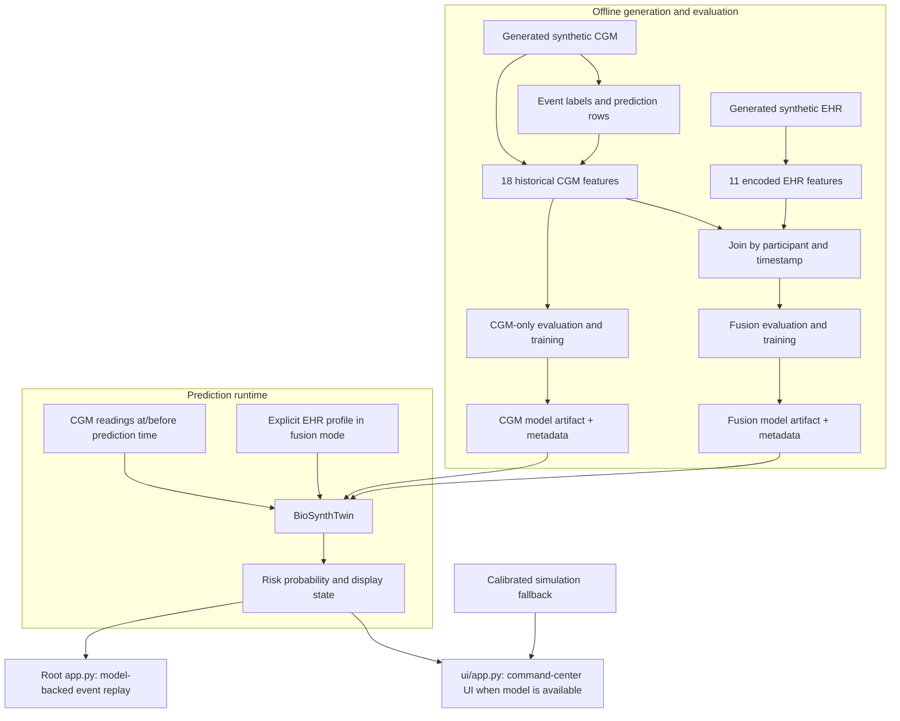

# Architecture

BioSynth has an offline data and training pipeline, a reusable prediction runtime, and two Streamlit entry points. The command-center UI (`ui/app.py`) and the model-backed replay (`app.py`) are separate applications with different responsibilities.

## System flow

## Source ownership

| Layer | Source of truth | Responsibility |
| --- | --- | --- |
| Configuration | `configs/` | Source data locations and model settings. |
| Synthetic data generation | `scripts/generate_synthetic_*.py` | Generate simulated CGM and EHR data. |
| Labels and features | `scripts/build_*` | Detect engineering events, create targets, calculate features, and join streams. |
| Evaluation and training | `scripts/cross_validate_*.py`, `scripts/train_*` | Evaluate participant-separated models and save full-data artifacts. |
| Prediction contract | `src/biosynth_twin.py` | Validate mode and inputs, filter historical CGM, build features, run the model, return state. |
| Guided event replay | `app.py` | Select a synthetic event, timestamp, and model mode; call the runtime. |
| Command-center UI | `ui/app.py`, `ui/assets/` | Render dashboard views and use the runtime or simulation path. |
| Contracts | `tests/test_biosynth_twin.py` | Check important runtime behavior. |

## Model inputs and data boundary

The target `pre_event_target` labels whether a new excursion above the engineering threshold of 180 mg/dL begins within 120 minutes. Label generation can inspect future readings to establish the training answer. Prediction features cannot.

At prediction time, `BioSynthTwin` keeps rows with timestamps at or before the requested prediction timestamp and calculates features from the 60-minute history window:

- CGM-only mode builds 18 trajectory features.
- Fusion mode adds 11 encoded values from a caller-supplied static EHR profile, for 29 ordered features total.

Participant ID, simulation phenotype, event ground truth, simulator parameters, and future CGM are not model features. Fusion mode requires a complete EHR profile; the runtime does not silently change to CGM-only mode.

## Application boundaries

| App | Model behavior | Data behavior |
| --- | --- | --- |
| `ui/app.py` | Tries to load the CGM-only runtime. Its calibrated simulation path remains available if loading fails. | Uses synthetic files when present and demo profiles for the command-center display. |
| `app.py` | Uses `BioSynthTwin` for guided replay and offers CGM-only and fusion modes. | Reads the generated participant CGM, EHR, and detected-event data; requires model artifacts. |

The command-center forecast/simulation calculations are presentation logic and should not be mistaken for runtime inference when the sidebar reports a fallback. The root replay is the direct model-backed demonstration.

## Generated artifacts

The data builders write under `data/` and `reports/`. Training scripts write `.joblib` model files under `models/`; Git ignores model binaries. Model metadata JSON files preserve the feature order and reference evaluation metrics. A fresh clone may therefore contain metadata without the model binary needed to run a model-backed interface.

Hall 2018 remains a separate CGM-only evidence branch. It does not validate the synthetic EHR + CGM fusion model. For measured results and the interpretation, see the [model card](model_card.md).
